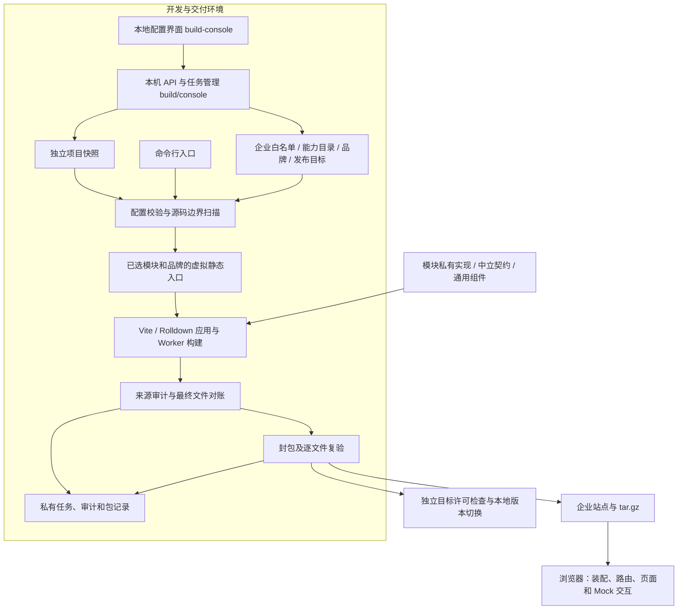

# enterprise-deploy 当前项目架构设计

本文说明本仓库当前 Vue 实现的实际架构，依据 `config/`、`src/`、`build/`、`build-console/` 和 `tests/` 中的代码整理。基线为提交 `8b007e4`，核对日期为 **2026-10-26**。本文中的“已实现”仅指当前代码具备的行为；业务后端、真实身份认证、外部服务接入和远端部署均不属于当前实现。

## 1. 项目目标与系统边界

项目用同一套源码维护标准版和多个企业定制版，在构建时决定每个企业实际交付的能力。标准版默认开放全部功能和页面；定制版根据企业白名单改变菜单、页面、操作、字段、表格列、详情页签、外部资源及主体展示。

项目需要同时回答两个问题：**页面是否按配置变化，以及未选择能力的实现和专属资源是否从交付物中排除**。因此，运行时隐藏控件只是权限呈现的一部分，交付资格还依赖源码边界、构建图、最终文件和压缩包的完整校验。

“裁剪代码”指不把未选能力编入该企业的产物。仓库仍保留这些能力的源码，供标准版和其他企业构建使用。共享框架、通用组件及已选功能仍然需要的业务数据也会保留。例如，关闭订单金额列会排除该列的渲染实现，但不会删除新建订单仍需要的金额字段和数据。

系统分为三个运行范围：

| 范围                 | 使用者               | 职责与交付边界                                                             |
| -------------------- | -------------------- | -------------------------------------------------------------------------- |
| 企业业务应用         | 业务页面使用者       | 按企业装配的 Vue SPA，运行本地演示业务；客户站点只包含批准的页面代码和资源 |
| 本地配置与打包控制台 | 开发、测试及交付人员 | 编辑企业白名单、预览依赖变化、执行真实构建、查看日志、下载及预览制品       |
| Node 构建与交付工具  | 控制台子进程或命令行 | 策略校验、静态入口生成、来源审计、封包复验、本地发布与回滚                 |

控制台不是业务功能集合页。短信登录、扫码登录、认证、充值等能力放在实际业务页面中；控制台管理这些能力是否交付。

## 2. 总体结构



业务应用与控制台都使用 Vue 3 和 TypeScript，但入口、职责和部署范围独立。业务应用的入口是 `src/composition/main.ts`；控制台入口是 `build-console/src/main.ts`，由 `build/console/server.ts` 启动的本机服务承载。

当前锁定的主要工具为 Vue `3.5.44`、Vue Router `5.4.0`、Vite `8.3.4`、TypeScript `5.9.3`。构建守卫适配 Vite 8 / Rolldown 的实际接口。Node 要求 `^22.12.0 || >=24.0.0`；封包使用系统 `tar`。具体版本以 [package.json](../package.json) 和锁文件为准。

### 2.1 源码分层与依赖方向

| 层           | 位置                 | 责任                                                                         |
| ------------ | -------------------- | ---------------------------------------------------------------------------- |
| 构建配置     | `config/`            | 用纯数据定义企业范围、能力归属、依赖、品牌和发布目标                         |
| 模块契约     | `src/contracts/`     | 定义路由、菜单、扩展点、字段、列、页签、工作区及服务接口，不持有具体模块实现 |
| 应用装配     | `src/composition/`   | 消费唯一业务注册表、校验贡献、创建运行时及路由、按顺序激活模块               |
| 核心壳       | `src/core/`          | 工作台布局、独立布局、权限判断、活动总线、404 和资源加载失败提示             |
| 共享实现     | `src/shared/`        | 通用表单、弹窗、扩展点、导览、请求状态和本地 Mock 传输机制                   |
| 业务能力     | `src/modules/<id>/`  | 各自拥有页面、操作、校验器、样式、资产、Worker 和服务实现                    |
| 构建与交付   | `build/`             | 完成策略、图守卫、审计、封包、预览和本地发布                                 |
| 本地工具界面 | `build-console/src/` | 企业配置和构建任务交互，不进入客户站点                                       |

模块可以使用自身文件、中立契约、核心服务和共享组件。**模块不能直接导入另一个模块的私有实现，即使两个模块都已启用且存在 `requires` 关系。** 核心及共享层也不能反向导入业务模块。

唯一被批准汇总业务入口的来源是生成的 `virtual:enterprise-modules`，且只有 composition 可以消费它。业务模块通过中立工作区接口、扩展点上下文或依赖注入协作，避免宿主页面为了显示一个可选按钮而导入其实现。

依据：[来源与依赖边界](../build/policy/origin.ts)、[功能契约](../src/contracts/feature.ts)、[装配实现](../src/composition/assemble.ts)。

## 3. 企业配置与能力模型

### 3.1 三类配置的职责

| 配置                           | 关键字段                                                                      | 含义                                                           |
| ------------------------------ | ----------------------------------------------------------------------------- | -------------------------------------------------------------- |
| `config/enterprises/<id>.json` | `schemaVersion`、`enterpriseId`、`enabledModules`、`brandingId`               | 一个企业完整且显式的交付白名单，无隐式继承或缺省全量降级       |
| `config/module-catalog.json`   | `id`、`entry`、`requires`、`conflicts`、`ownedRoots`；顶层 `approvedPackages` | 全部能力的构建入口、安装依赖、互斥关系、私有归属根及批准依赖包 |
| `config/brands.json`           | `name`、`entry`、`ownedRoot`                                                  | 品牌入口和品牌资源归属                                         |

此外，`config/delivery-targets.json` 独立声明发布目标的企业、品牌和 `allowedModules` 上限。保存企业配置不会自动扩大发布目标许可。

以下是一个可通过现有依赖校验的最小新建订单配置示例；它是说明用数据，不会自动写入配置目录：

```json
{
  "schemaVersion": 1,
  "enterpriseId": "enterprise-example",
  "enabledModules": ["orders", "order-create", "order-field-customer", "order-field-amount"],
  "brandingId": "brand-b"
}
```

`order-create` 显式依赖订单宿主与两个必填字段。可选客户参考号、列表列和详情页签并不因为启用了订单模块而自动交付。

配置校验拒绝未知字段、未知企业或能力、重复 ID、空白名单、缺失依赖、依赖环、互斥组合、重叠归属和无归属入口。目录表即使存在于未选范围内，也必须结构合法且无依赖环。校验器复制、排序并冻结规范化白名单，不修改调用者输入；同一份已冻结配置可以重复校验，适用于控制台保存与任务启动的连续处理。

`requires` 是安装前提，不是私有源码导入许可。构建侧只验证配置是否已满足依赖，不偷偷补选；控制台的批量操作可以计算依赖闭包，但必须先展示变更预览，再应用到草稿。

依据：[配置模型](../build/policy/types.ts)、[解析与依赖排序](../build/policy/manifest.ts)、[控制台依赖规划](../build/console/grouping.ts)。

### 3.2 当前能力规模与配置实例

所有粒度都使用同一份 `enabledModules` 白名单，统一参与入口生成、归属检查和交付审计。能力类型由控制台元数据分类，构建策略不因粒度不同而放宽边界。

| 类型           |    数量 | 示例                                                       | 裁剪责任                                                               |
| -------------- | ------: | ---------------------------------------------------------- | ---------------------------------------------------------------------- |
| 业务模块       |      12 | `orders`、`stocktakes`、`access`、`company`                | 页面、工作区或应用级功能；其中 `onboarding` 是导览能力，无独立业务路由 |
| 按钮与操作     |      49 | `order-create`、`approval-review`、`billing-recharge`      | 入口、弹窗或独立流程、操作逻辑及专属资源                               |
| 表单字段       |      25 | `order-field-reference`、`inventory-transfer-field-target` | 控件描述、依赖联动、校验与解析逻辑                                     |
| 表格列         |      15 | `order-column-amount`                                      | 列头、单元格渲染及列专属计算                                           |
| 详情页签       |       9 | `order-detail-extra`、`stocktake-detail-history`           | 页签入口、内容组件及私有逻辑                                           |
| 共享 Mock 资源 |      10 | `resource-sms`、`resource-pay`                             | 外部依赖的本地模拟服务、夹具标记和专属资产                             |
| 合计           | **120** |                                                            |                                                                        |

当前仓库已有以下企业配置。新增能力或修改配置后，应从目录表和企业 JSON 重新统计，不把这里的数字当成协议常量。

| 企业                        | 启用数 | 用途                                                   |
| --------------------------- | -----: | ------------------------------------------------------ |
| `enterprise-a`              |    120 | 标准版全量对照，使用 `brand-a`                         |
| `enterprise-b`              |      1 | 仅订单基础模块，验证没有操作、字段、列扩展时的最小页面 |
| `enterprise-mock-custom`    |     17 | 登录、账号、账单和运维的 Mock 定制对照                 |
| `enterprise-granular-proof` |     20 | 订单与审批的细粒度实际交付验证                         |
| `teststd`                   |     31 | 订单、库存、短信登录及短信服务的组合                   |

完整功能和权限列表见 [细粒度功能模块](feature-modules.md)。

## 4. 浏览器装配、权限与生命周期

### 4.1 静态注册表到运行时

`build/plugins/registry.ts` 仅为已选能力生成静态 `import`，按依赖拓扑顺序导出模块数组；品牌由独立的 `virtual:enterprise-brand` 入口引入。这里没有浏览器运行时读取全量能力目录，也不使用 `import.meta.glob` 搜索全部业务源码。

浏览器启动依次执行：

1. 校验注册表模块 ID 与编译注入的 `__BUILD_INFO__.modules` 一致。
2. `assembleModules` 收集路由、菜单、扩展点、表单字段、表格列和详情页签；检测 ID、路由路径、菜单引用、字段键、字段依赖环等冲突。
3. 为每项贡献附上 `owner`，按顺序及 ID 排序，建立管理员、普通成员和无权限三种演示权限集合。
4. 创建运行时、活动总线和 Vue Router，把路由的 owner、permission、layout 写入路由元信息。
5. `activateModules` 串行激活模块，通过 `provide` 注入本次会话的工作区与 Mock 服务，完成后挂载应用。

路由组件和部分贡献组件继续使用字面量动态导入延迟加载。延迟加载控制加载时机；企业物理裁剪由前面的静态入口选择和边界检查保证。

`/` 优先进入订单页，否则进入首个工作台路由，再否则进入首个可用路由。当前并未实现“未登录强制跳转登录页”的真实认证守卫。未交付的页面没有路由注册，直接访问进入 404。

依据：[入口生成](../build/plugins/registry.ts)、[浏览器启动](../src/composition/main.ts)、[装配校验与生命周期](../src/composition/assemble.ts)。

### 4.2 三种可用范围

功能能被用户访问，需要同时落在以下范围内：

```text
本次已交付能力 ∩ 运行时 licensedModules 集合 ∩ 当前身份的 owner:permission 集合
```

未交付能力首先不存在于装配结果中。已交付能力再由 `runtime.can(owner, permission)` 控制菜单、页面和扩展；字段、列及页签也按所属 owner 和权限筛选。核心壳控制页面是否渲染，操作提交入口还检查权限。

`licensedModules` 初始值来自本次构建；当前没有远端许可证服务。默认演示身份为管理员，界面可以切换普通成员或无权限。登录模拟只用于验证流程及页面定制，不创建真实会话或服务端授权。

依据：[权限交集](../src/core/runtime.ts)、[页面呈现](../src/core/App.vue)、[扩展点筛选](../src/shared/ExtensionPoint.vue)。

### 4.3 状态与资源生命周期

订单、库存、审批、盘点、账单和媒体状态由对应宿主模块持有，通过中立 InjectionKey 或上下文提供给扩展。状态在本次应用会话内保留，页面切换后仍可访问；刷新后重置。导览完成状态等少量界面偏好由浏览器存储记忆，不是业务数据库。

跨模块操作通过 `ActivityBus` 发布事件；`audit-log` 启用时订阅成功操作，形成会话内审计视图。关闭操作审计不影响其他模块执行，业务模块也不直接依赖审计实现。

模块入口描述能力，实际启动通过显式 `activate` 完成。激活失败会逆序回收已启动模块；正常清理也按逆序执行且幂等。组件卸载取消未完成请求、销毁导出 Worker，并按各功能需要释放本地文件预览资源。

业务输入模型、提交状态和并发限制由具体操作模块管理。共享表单机制负责解析已装配字段、条件必填、依赖变化与权限变化后的状态处理。审批初审和复核分别拥有实现，关闭复核不会把大额审批自动改成直接通过；库存盘点过账仍检查库存版本、预留量和全部明细。

## 5. 页面与定制呈现

业务页面由宿主布局与独立贡献组成，不按外部供应商名称拼装调试卡片。

| 页面范围       | 路由                                                                       | 装配方式                                                           |
| -------------- | -------------------------------------------------------------------------- | ------------------------------------------------------------------ |
| 业务工作台     | `/orders`、`/inventory`、`/stocktakes`、`/approvals`、`/reports`、`/audit` | 宿主负责页面和状态，可选按钮、字段、列、详情内容通过契约扩展       |
| 登录与账号入口 | `/access`、`/register`、`/forgot-password`、`/admin-login`                 | 独立布局；登录方式、注册、找回密码、人机验证和后台扫码分别拥有实现 |
| 账号与认证     | `/account`、`/account/personal-auth`、`/account/enterprise-auth`           | 设置项按能力排列，个人和企业认证分别注册流程路由                   |
| 充值与账单     | `/billing`                                                                 | 宿主保存余额和交易，充值、逐笔退款、对账单、发票独立贡献           |
| 创作与文件     | `/media`                                                                   | 按已选能力显示图片、视频和导出流程                                 |
| 运维与支持     | `/operations`、`/operations/feedback`、`/operations/approval`              | 支持、通知告警、管理安全、助手按贡献分组，部分流程注册独立路由     |
| 主体信息       | `/company`                                                                 | 主体页、登录品牌展示、页脚、示例代码和邮件模板由同一能力提供       |

`FeatureRoute.layout` 支持 `workspace` 与 `standalone`。独立布局用于登录类页面，工作台布局包含侧栏、顶栏及业务内容。`company` 可以通过 `accessBrand` 和 `shellFooter` 注入主体信息；`brandingId` 控制主题资源，二者职责不同。

以 `enterprise-mock-custom` 为例，实际保留四个宿主页面、七个操作与六个共享服务：

| 定制选择                 | 页面结果                                             | 实现结果                                                     |
| ------------------------ | ---------------------------------------------------- | ------------------------------------------------------------ |
| 登录只保留短信方式       | 没有多方式页签、注册链接、找回密码链接或人机验证入口 | 微信登录、注册、找回密码、人机验证及专属路由或资产不进入交付 |
| 账号只保留企业认证       | 没有个人实名及其他绑定操作                           | 相应功能实现排除；企业认证继续使用 CloudAuth Mock            |
| 账单保留退款和对账单     | 没有充值与发票入口，交易记录仍可退款和下载对账单     | 充值、发票实现排除，支付服务继续供退款与对账单使用           |
| 运维保留邮件、告警和模型 | 只出现相关通知与助手内容                             | 其他运维操作及独立路由排除                                   |
| 不选择媒体和主体能力     | 没有对应菜单、主体页、登录主体和主体页脚             | 对应 owner 的代码与专属资源排除                              |

宿主对空扩展提供可用的基础状态。关闭一个可选列不改变其他页面的同名数据，关闭一个可选字段也不应顺带关闭无依赖关系的按钮。

## 6. 外部资源与 Mock 服务设计

当前 11 类外部依赖全部在本地模拟。前十类是独立的 `resource-*` 服务 owner，第十一类是 `company` 主体展示能力。

| 外部依赖               | 当前 owner           | 使用场景                                   |
| ---------------------- | -------------------- | ------------------------------------------ |
| 阿里云短信             | `resource-sms`       | 登录、注册、找回密码、换绑手机、注销验证   |
| 阿里云 Captcha 2.0     | `resource-captcha`   | 登录流程的人机验证                         |
| 阿里云 CloudAuth       | `resource-cloudauth` | 个人实名、企业人脸认证                     |
| 微信开放平台           | `resource-wechat`    | 扫码登录、微信绑定                         |
| 微信支付               | `resource-pay`       | 充值、退款、对账单                         |
| 企业微信               | `resource-wecom`     | 后台审批、后台扫码、二次认证改密           |
| 腾讯企业邮 SMTP        | `resource-smtp`      | 邮件通知、邮箱绑定                         |
| 阿里云 OSS             | `resource-oss`       | 头像、图片和视频、导出文件、发票           |
| 飞书开放平台与多维表格 | `resource-feishu`    | 反馈、工单、Hermes 交互与告警              |
| 智能运维助手           | `resource-hermes`    | Hermes 模型调用                            |
| 公司主体信息           | `company`            | 品牌、备案、域名、文档链接、示例与邮件模板 |

服务和功能分别选择。例如 `access-sms-login requires access + resource-sms`，`billing-recharge` 与 `billing-refund` 均依赖 `billing + resource-pay`。缺少服务时配置失败，而不是进入页面后静默降级。

服务模块在 `activate` 中通过 `mockServiceKey(id)` 注入 `MockService`。功能通过契约取用服务，不能导入 `resource-*` 私有实现。`src/shared/mock/service.ts` 只提供通用的本地异步、取消及结果机制；服务名称、标记和资产归各自服务 owner 所有。

```text
功能组件 → useRequest / 功能自身请求流程 → MockService 中立契约
                                             ↑
                              resource-* 激活时 provide
```

正常页面呈现校验、提交中、成功、失败和可重试状态。自动化测试通过 `sessionStorage["enterprise:mock:<operation-id>"]` 设置 `failure` 或 `empty`，不在产品页增加“模拟响应”控件。

验证码、支付确认、企业人脸步骤和模型回复均为模拟；不会发送真实短信、发起真实支付、采集真实人脸或调用模型。部分输出是浏览器本地真实生成的文件，例如 CSV、头像预览和可播放短视频，它们仍不代表远端存储或真实外部交易。

共享服务按显式配置保留。关闭充值但保留退款时仍需要支付服务；即使关闭所有使用功能，已显式选中的资源也不会被构建器自动取消。控制台“关闭资源”的批量操作会预览依赖它的所有已选功能。

依据：[Mock 契约](../src/contracts/mock.ts)、[本地传输](../src/shared/mock/service.ts)、[请求状态](../src/shared/product/useRequest.ts)、[完整页面与资源映射](external-resources.md)。

## 7. 构建时物理裁剪

### 7.1 唯一受控构建链路


`npm run build` 调用 `build/enterprise.ts`，执行配置和可达源码校验、`vue-tsc --noEmit`、隔离编译、输出审计及审计记录复验。直接执行 `vite build` 会被 `vite.config.ts` 拒绝。

企业与构建环境分别输入。命令行支持 `development`、`staging`、`production`，控制台只开放后两种交付模式。staging 和 production 固定使用生产框架条件。配置拒绝 `.env.local` 和对应模式的 `.local` 覆盖；前端公开环境变量前缀为 `PUBLIC_`，这些值会进入前端范围，不用于保管秘密。

每次构建使用独立 release ID，不能复用已有任务目录。没有共享的 `src/generated` 企业入口，因此命令行可以并行构建不同企业；构建中发生相关源码、配置、策略或锁文件变化会使资格校验失败。控制台出于配置保存与任务管理需要，另行串行化操作。

### 7.2 四层验证

| 层次       | 机制                                                                           | 拒绝的典型问题                                                                 |
| ---------- | ------------------------------------------------------------------------------ | ------------------------------------------------------------------------------ |
| 源码闭包   | 从已选入口、当前品牌和 HTML 入口扫描 TS / Vue / CSS / 资源；优化前检查来源与边 | 禁用 owner、跨模块私有导入、shared 反向引用、barrel 或死分支绕过、不可追踪加载 |
| 构建上下文 | 应用和每个实际 Worker 各有守卫实例，采集模块、依赖、分块及资产来源             | 未分类来源、未知虚拟模块、Worker 漏审、输入指纹变化                            |
| 最终站点   | 合并上下文输出，检查来源、路径、引用、实际文件集合、大小及 SHA-256             | 无来源输出、文件碰撞、额外 map / gz / br、缺失或篡改文件                       |
| 压缩包     | 审计绑定、整包摘要、成员列表、普通文件类型及每个成员的字节长度和哈希           | 额外目录或文件、路径穿越、软链接或特殊成员、包内替换和缺失                     |

归属识别先规范 file URL、别名解析结果和查询后缀，再使用 `realpath` 判断真实来源。模块与品牌私有根优先于通用依赖包批准规则；不能把工作区私有包通过软链接伪装成共享依赖。

源码扫描会检查优化前的导入，即使构建器最终可以消除该分支，也不允许禁用模块曾经进入源码依赖。审计结论以 owner 和内容来源为依据；产物大小变化与字符串抽查仅是补充证据。

当前支持普通 Vue SFC、TypeScript、普通 CSS、登记的静态资源与 Vite ES Worker。`publicDir` 复制、资产内联、交付 source map 和预压缩副本关闭。计算动态导入、glob、远程代码加载、未知虚拟模块、SharedWorker、Wasm、CSS 预处理器、自定义 SFC 块以及未经适配的 Service Worker / SSR 加载会被拒绝。没有启用的上下文在审计中明确记录为不适用。

依据：[扫描器](../build/policy/scan.ts)、[应用和 Worker 守卫](../build/plugins/guard.ts)、[输出审计](../build/audit/files.ts)、[构建参数](../build/config.ts)。

## 8. 审计证据与制品身份

审计记录使用 schema version 1，策略另有 `policyVersion`。`AuditRecord` 包含以下身份和证据：

| 内容       | 记录与用途                                                                         |
| ---------- | ---------------------------------------------------------------------------------- |
| 构建身份   | 企业、release ID、环境、品牌、拓扑排序后的启用能力                                 |
| 源码来源   | Git commit、dirty 状态、源码树摘要；无 Git 时仍记录内容摘要                        |
| 策略身份   | `configHash`、`policyHash`、`lockfileHash`；策略摘要包含目录表、品牌数据和策略代码 |
| 工具链     | Node、Vite、Rolldown、Vue、Router、编译器等实际版本                                |
| 入口与源码 | 注册表摘要、来源 owner、源码指纹、导入 / 资源 / Worker 边                          |
| 编译上下文 | 应用及 Worker 成功记录、模块集合和输出来源                                         |
| 文件身份   | 批准路径、类型、来源、大小、SHA-256 和站点总摘要                                   |
| 校验结果   | 禁用来源数、未知来源数和文件差异均为零，三类审计通过                               |

`cacheKey` 绑定源码树、配置、策略、锁文件、环境和工具链，当前用于构建身份校验；本仓库没有实现远端构建缓存服务。

`PackageRecord` 把企业与 release ID、`auditHash`、`siteHash`、`packageHash` 绑定。封包先从待审计站点复制批准文件到 release 站点，再创建 `.tar.gz` 并逐项复验。之后下载、预览和发布也调用复验，不只信任先前的成功日志。

复验重新加载对应构建根目录中的配置和策略，并核对当前工具链。历史记录需要与该根目录现状兼容；命令行使用工作区根目录，控制台使用该任务的项目快照根目录。

这是在受控工具链与私有记录可信的前提下建立的来源证据链。当前没有制品数字签名或外部证明服务，哈希不能替代私有审计记录和构建脚本的访问控制。

依据：[审计类型](../build/audit/types.ts)、[记录解析与复核](../build/audit/record.ts)、[封包与归档复验](../build/package.ts)。

## 9. 本地配置与打包控制台

### 9.1 配置草稿与任务结果

界面按业务模块管理能力，操作与字段在同一流程分组，列表和详情独立管理。搜索及筛选只影响展示；整组操作作用于完整模块，并先预览依赖闭包或反向依赖的变化。

保存使用文件摘要作为 `revision`。请求携带 `expectedRevision`，配置已被其他页面或编辑器修改时拒绝覆盖；写入通过普通文件检查、临时文件与原子替换完成。构建按钮执行“校验 → 保存 → 固定项目快照 → 启动任务”，草稿和历史任务结果始终分别保存。

### 9.2 快照与子进程

每个任务使用唯一 `build-<uuid>` ID。`snapshotProject` 复制 `src`、`config`、`build`、控制台、构建入口、锁文件、环境文件及额外 owned roots，并重新写入本次已保存的企业配置。源码要求普通文件与目录，不通过解引用源码软链接偷带其他内容。

快照通过软链接引用本项目的 `node_modules`，没有单独复制一份依赖运行时。构建会记录实际工具链版本及参与构建的输入证据，因此快照固定了项目输入，但不等于隔离的容器或独立依赖安装。

子进程在快照根目录执行同一套 `buildEnterprise → packageBuild → verifyPackage`。五个阶段为 `validating → compiling → auditing → packaging → verifying`，任务状态为 `running / succeeded / failed`。子进程退出成功后，父进程还会独立复验企业、环境、配置摘要及制品身份，才写入成功结果。

任务日志和结果保存在磁盘，重启后读取最近任务。上次未完成的 running 任务会标记失败，不会自动获得交付资格。正常停止会取消构建进程组；失败重试创建新任务，不复用旧 ID。

### 9.3 本机 API 与并发边界

| 接口                          | 行为                                                             |
| ----------------------------- | ---------------------------------------------------------------- |
| `GET /api/bootstrap`          | 读取能力摘要、品牌、企业配置、最近任务、当前任务及本地会话 token |
| `PUT /api/enterprises`        | 版本校验后保存企业配置                                           |
| `POST /api/builds`            | 保存并创建快照构建，返回任务身份                                 |
| `GET /api/builds/:id`         | 查询任务阶段、日志与结果                                         |
| `GET /api/builds/:id/package` | 再次复验后返回批准压缩包                                         |
| `GET /api/builds/:id/report`  | 再次复验后下载私有审计报告                                       |
| `GET /api/builds/:id/preview` | 再次复验后跳转到固定版本的本机预览                               |

服务仅监听 `127.0.0.1`，校验 Host、Origin 和跨站来源；写请求要求同源及 `X-Console-Token`。接口接受结构化配置与登记任务 ID，不接受任意 shell 命令或文件路径。控制台静态服务也限制可读取范围，不公开配置目录和私有快照。

`.console/operation.lock` 使同一项目的保存与构建串行执行，多个控制台实例共享这一边界。异常退出的遗留锁需要先确认原进程已结束再处理。控制台是本地工具，当前没有远端多用户登录、角色授权、队列集群或云端任务调度。

依据：[配置存储](../build/console/store.ts)、[任务管理](../build/console/jobs.ts)、[快照](../build/console/snapshot.ts)、[HTTP 服务](../build/console/server.ts)、[控制台操作说明](build-console.md)。

## 10. 文件布局与信息隔离

命令行构建的文件位置如下。控制台构建在 `.console/runs/<job-id>/project/` 下使用相同布局。

```text
config/enterprises/<enterprise>.json           可纳入 Git 的企业白名单
.work/<enterprise>/<release-id>/site/          本次构建待审计站点
.audit/<enterprise>/<release-id>/audit.json    私有完整来源与文件证据
.audit/<enterprise>/<release-id>/package.json  私有包摘要绑定
.artifacts/<enterprise>/<release-id>.tar.gz    可传输企业站点包
release/<enterprise>/<release-id>/site/        按批准清单复制的站点
.console/runs/<job-id>/job.json                持久化任务、日志和结果
.console/runs/<job-id>/request.json            内部任务请求
.console/runs/<job-id>/project/                任务项目快照
.deploy/<target>/<generation>/site/            私有本地发布版本
deployments/<target>/current                   当前发布站点的符号链接
```

客户包只包含本次批准的站点文件。全量模块目录、其他企业配置、控制台、源码快照、绝对源码路径、完整审计和 source map 不进入客户站点。业务页面包含当前企业、版本和启用能力等必要构建信息，不能把这些元信息与私有实现源码等同处理。

审计报告是本地交付管理证据，独立下载，不随客户站点公开。以上运行目录及制品由 `.gitignore` 排除，配置、构建策略、测试与文档纳入源码管理。

## 11. 预览、本地发布与回滚

预览先复验封包，再把批准站点的实际字节读入内存，仅监听本机。已经启动的预览不继续读取后来可能被修改的磁盘文件。只有无扩展名且接受 HTML 的路由请求可以 SPA 回退；缺失 JS、CSS、图片和私有文件返回 404，避免旧资源地址被误判为存在。

发布由 `build/publish.ts` 单独执行，控制台打包成功不会自动发布。发布流程是：

1. 查找已登记目标并复验对应企业制品。
2. 要求 production 环境、品牌匹配、全部启用能力位于目标 `allowedModules` 上限内。
3. 对目标加独占锁，从同一份已验证归档字节提取到私有暂存版本，再对文件集合和哈希复验。
4. 固化版本后，通过原子重命名切换 `deployments/<target>/current` 符号链接，记录发布摘要。

Web 服务根目录应指向 `current`，旧版本与部署记录保留在 `.deploy` 私有目录。当前适配器只完成本地文件部署，不包含远程机器、容器平台或 CDN 接入。

回滚复用 publish，输入历史 release ID，并重新执行当前门禁。企业配置、策略、锁文件或工具链不兼容时，历史包会被拒绝，应按当前约束重新构建恢复版本。目标许可收缩后不能借回滚重新交付超范围能力。浏览器已缓存的旧代码无法由本地文件切换撤回；真实 CDN、Service Worker 和远端存储失效需由对应部署适配器处理。

依据：[冻结预览](../build/preview.ts)、[本地发布与目标校验](../build/publish.ts)。

## 12. 验证策略与现有证据

验证同时覆盖业务呈现与物理交付。仅检查按钮不可见，无法证明私有实现没有进入其他分块或 Worker。

| 验证层         | 入口                                                        | 覆盖范围                                                                       |
| -------------- | ----------------------------------------------------------- | ------------------------------------------------------------------------------ |
| 静态与单元     | `npm run check`                                             | 格式、严格类型、全部企业源码边界、策略、装配、业务模型、控制台存储及 API       |
| 封包业务浏览器 | `npm run test:e2e`                                          | 真实生产包的业务流程、权限、细粒度字段 / 列 / 页签、深链、失败恢复、盘点和窄屏 |
| 控制台浏览器   | `npm run test:console`                                      | 依赖预览、保存冲突、真实构建、失败重试、刷新恢复、固定预览与下载               |
| 外部资源流程   | `npm run test:external`                                     | 全量和定制包的 28 项 Mock 业务流程、独立登录布局、状态、路由和资源裁剪         |
| 实际交付对照   | `node --import tsx tests/verification/granular-delivery.ts` | 同源构建全量与 20 项精简版本，逐 owner、标记、资产、网络与压缩包复验           |

架构反向用例检查别名、软链接、barrel、raw、CSS、死分支、Worker 及未知输出等绕过方式，以及文件、审计、压缩包篡改和许可收缩。控制台还测试伪造成功日志不能绕过父进程复验；配置重复校验包含冻结数组回归，避免保存后任务启动失败。

[GitHub Actions](../.github/workflows/enterprise-modular.yml) 在 push 和 pull request 时安装锁定依赖，执行 check 及三组浏览器测试，并保留审计、压缩包与 Playwright 报告。

已提交的当前实现证据包括 [业务页面与 Mock 定制验证](verification-2026-10-26.md) 和 [20 项精简企业交付验证](verification-granular-delivery-2026-10-26.md)。后者记录排除 100 个 owner、专属代码与资产对照、封包字节复验及实际浏览器操作。各记录代表当次版本的结果，不能用旧测试数量代替未来修改后的重跑。

## 13. 扩展规范与设计取舍

新增企业时，先准备完整白名单并选择已登记品牌；需要本地发布时另行登记目标许可。标准版全量同样由显式白名单表达，新增能力不会自动进入所有企业。

新增能力时，应把私有页面、算法、校验器、样式、资产、Worker 和专属包放进其 `ownedRoots`，登记入口和最小依赖，再通过中立契约提供贡献。宿主不能导入扩展实现。确需增加扩展点或契约时，先定义其数据与生命周期，再分别由宿主和贡献者消费。依赖包需具体批准，不能放开整个 node_modules。

必需字段应成为操作的显式依赖；可选字段随其 owner 交付解析器。表格列和详情内容分别归属，不能因为复用一个数据字段而被捆绑裁剪。新增真实服务需要定义实际协议及错误模型，当前通用 MockService 只服务于页面定制与裁剪测试，不是已完成的生产 SDK 抽象。

每个可选能力至少验证启用和关闭两个方向，并检查必要依赖、页面变化、源码来源和封包结果。新增加载上下文或资源格式时，应同时扩展来源适配器与反向测试；升级 Vite / Rolldown 后需要重新验证完整守卫链路。

| 选择                       | 当前收益                                       | 需要承担的成本                             |
| -------------------------- | ---------------------------------------------- | ------------------------------------------ |
| 纯数据白名单与生成静态入口 | 每个企业可追踪、可重复审核，入口不触及禁用实现 | 配置必须完整维护，缺少依赖即失败           |
| 细粒度 owner               | 按按钮、字段、列和页签验证真实裁剪             | 文件和目录表数量增加，贡献契约必须稳定     |
| 模块间通过中立契约协作     | 宿主可在无扩展时独立运行，私有导入边界明确     | 需维护上下文、InjectionKey 和贡献冲突检查  |
| 来源及逐文件证据链         | 同时约束源码、Worker、输出和包内内容           | 工具链适配与审计开销增加，未知形式默认拒绝 |
| 本机快照及独立任务         | 后续编辑不改变已完成任务，下载与结果可绑定     | 占用磁盘，依赖运行时仍引用本项目安装       |

当前保证以受控构建代码、目录表和私有审计可信为前提，不能自动识别被人为复制到 shared 的业务语义，也不能防御任意恶意构建插件。真实认证、后端逐请求与字段授权、数据库持久化、外部服务密钥、远端部署和缓存清理需要在接入对应系统时补齐；本文不把这些列为已实现能力。

## 14. 阅读与运行入口

建议从本文建立全貌，再按任务阅读 [能力契约与权限清单](feature-modules.md)、[外部资源及页面定制](external-resources.md)、[控制台操作与快照](build-console.md) 和 [新手指引](onboarding.md)。开发和交付命令详见 [README](../README.md)。

```bash
npm ci

# 业务应用开发与本地配置控制台
APP_ENTERPRISE=enterprise-a npm run dev
npm run configure

# 每次使用新的 release ID，以下以 arch-a-001 为例
npm run build -- --enterprise enterprise-a --mode production --release-id arch-a-001
npm run audit -- --enterprise enterprise-a --release-id arch-a-001
npm run package -- --enterprise enterprise-a --release-id arch-a-001
npm run preview -- --enterprise enterprise-a --release-id arch-a-001 --port 5191

# 已登记目标的本地发布；历史版本回滚也使用这条命令并重新校验
npm run publish -- --target local-enterprise-a --release-id arch-a-001
```

业务开发服务默认 `127.0.0.1:5190`，控制台默认 `127.0.0.1:5193`。服务打印的实际地址为准；修改企业白名单后应重启业务开发服务，交付验收使用已封包生产站点。
