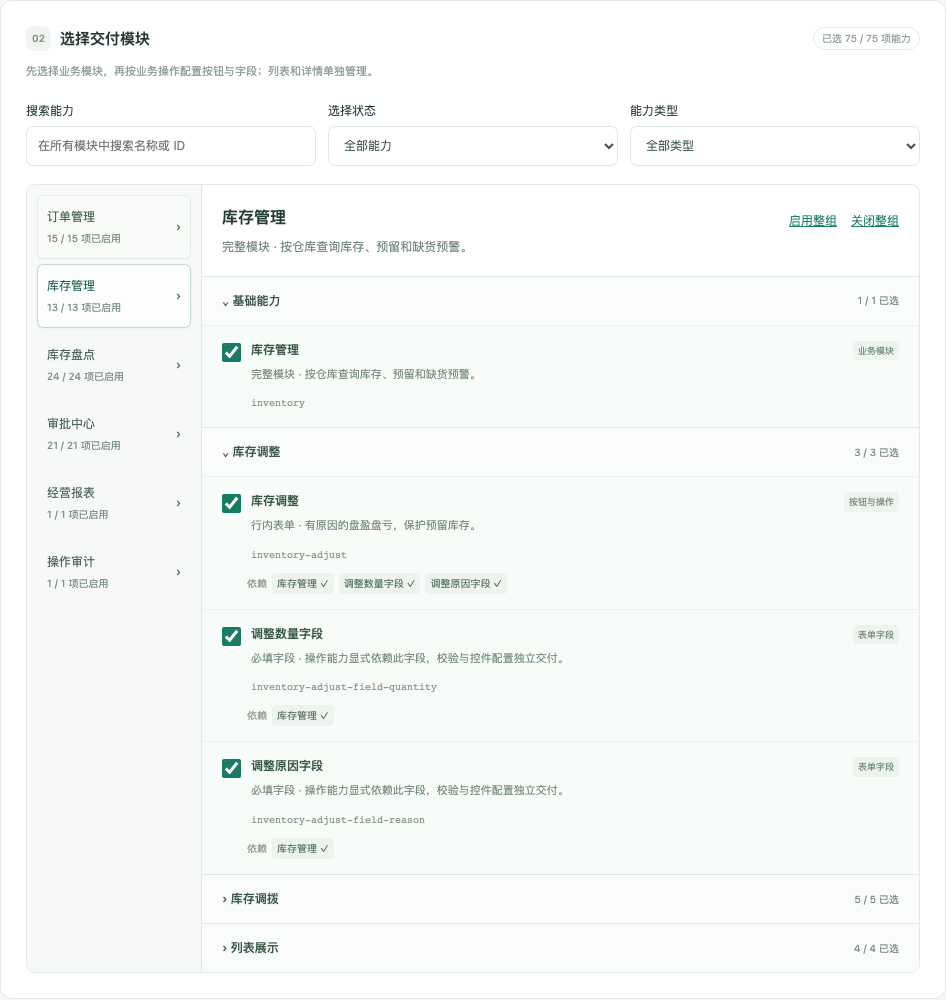

# 可视化企业配置与打包

控制台在浏览器中管理企业白名单，调用本项目相同的构建、审计和封包工具。企业业务应用与构建控制台使用独立入口；客户交付包只包含本次批准的站点文件。

## 启动与操作

在仓库根目录执行：

```bash
npm ci
npm run configure
```

打开 <http://127.0.0.1:5193>。如端口已占用，可设置 `CONSOLE_PORT=5293 npm run configure`，以终端打印的地址为准。

1. 选择已有企业，或选择「新建企业」并填写企业标识。
2. 从业务模块导航选择订单、库存、盘点、审批、报表、审计，或新增的登录、账号、账单、媒体、运维和主体页面。「外部资源（Mock）」分组管理共享模拟服务。在模块内展开业务操作，配置其按钮和字段；列表展示、详情与记录各自分组。单项勾选缺少依赖时提示并阻止提交。点击依赖名称可直接定位对应模块与能力。
3. 选择已登记品牌和生产 / 预发布环境。品牌资源取自 `config/brands.json`，环境用于本次构建。
4. 「保存配置」只写入企业清单；「保存并打包」先保存，再执行完整流水线。
5. 等待配置与类型校验、编译与模块裁剪、来源与文件审计、生成交付包、封包复验五个实际阶段。
6. 成功后下载 `.tar.gz` 交付包、预览固定版本，或单独下载私有审计报告。

模块级批量操作包括「启用整组」「关闭整组」和「补齐必需依赖」。每次先显示变更清单，点击「应用更改」后才修改草稿：启用计算完整依赖闭包，关闭计算所有已选反向依赖，包含跨模块的影响。例如启用盘点整组会列出库存基础能力；关闭库存整组会列出依赖它的盘点能力。取消预览不改变配置，保存仍须通过统一校验。

搜索在所有业务模块中定位能力，类型与已选状态筛选保留已有配置。左侧模块显示已选数与依赖问题数；右侧交付摘要和实际打包结果按模块折叠展示。筛选状态下的「整组」始终作用于完整模块，预览列出具体变化。

构建期间锁定配置表单，避免重复提交。刷新页面后会恢复当前任务，日志轮询在网络恢复后自动继续。已完成任务保留在最近任务列表，正常重启控制台后也可读取历史结果。

保存或构建失败时保留输入。外部编辑器或其他页面修改同一配置后，版本冲突会阻止覆盖；可明确选择「重新加载服务器配置」。切换企业或重新加载时，如有未保存修改，会先提示放弃或继续编辑。

## 新手指引

首次打开控制台会显示欢迎弹窗，点击「开始了解」依次定位企业配置、品牌与环境、模块导航、细粒度能力配置、交付摘要、保存与打包按钮、构建结果。右上角「新手指引」可随时重新查看，关闭或完成后会记住状态。导览只定位和说明，不触发配置保存或构建。详见 [新手指引](onboarding.md)。

新增 Mock 的功能、页面与服务各自独立选择。关闭共享服务的批量操作会预览全部使用功能；单独关闭操作时，其共享服务仍按显式选择保留。可选择 `enterprise-mock-custom` 对照 17 项能力的精简版本。完整映射和运行方式见 [外部资源 Mock 与定制规则](external-resources.md)。

## 配置和任务快照

企业清单保存到 `config/enterprises/<id>.json`，沿用 schema、模块依赖、互斥、归属与品牌校验。保存使用文件摘要作为版本号、普通文件检查、临时文件和原子替换。模块清单可以纳入代码评审。

每次打包有唯一任务 ID，并创建私有项目快照。快照固定实际源文件、构建策略、锁文件、环境文件和本次企业配置；子进程对快照执行原有完整流程，并保留原工作区的 Git 提交与 dirty 状态。源码目录要求普通文件和目录，源文件软链接不会在快照中被偷偷解引用；依赖运行时通过固定 node_modules 引用并记录实际工具链。

```text
.console/runs/<job-id>/job.json               持久化任务状态、日志和结果
.console/runs/<job-id>/request.json           内部构建输入
.console/runs/<job-id>/project/                固定项目快照
  .audit/<enterprise>/<job-id>/                私有审计与封包记录
  .artifacts/<enterprise>/<job-id>.tar.gz      本次交付包
  release/<enterprise>/<job-id>/site/          冻结站点
```

界面右侧的「本次交付配置」展示当前表单。完成后的「构建与交付」结果始终绑定其任务快照，包含企业、环境、任务 ID、启用和排除模块、文件数与包摘要。后续编辑表单、保存其他配置或新建任务，不会改变已有包的字节。

子进程退出成功或日志打印「通过」均不足以生成成功结果。控制台还独立检查快照的企业、环境、配置摘要、审计和包内每个文件。下载和进入预览时重新执行复验；篡改产物会被拒绝。已经启动的预览只服务此前校验并冻结的字节，不会读取后来被修改的文件。

客户包不包含控制台、私有审计或项目快照。审计报告下载是本机开发工具的独立操作，应保留在开发与交付管理环境中。

## 界面示例

下图展示按模块管理的控制台，操作与字段归在同一业务分组。批量修改先预览跨模块依赖，交付摘要默认按模块折叠。



另有 [390px 窄屏示例](assets/build-console-grouped-mobile.png) 和 [本机企业 B 的实际打包结果](assets/build-console-result.png)。

## 运行边界

服务只监听 `127.0.0.1`，校验 Host、Origin 和本地会话 token，不开放跨域写接口。接口只接受结构化企业配置和已登记任务 ID，不接受任意 shell 命令或文件路径。前端开发服务只允许控制台入口、共享接口契约、依赖和本实例的缓存目录，不能直接读取企业配置目录或私有快照。

同一项目通过 `.console/operation.lock` 串行保存和构建。正常退出会停止构建进程组、保存失败状态并释放所持锁；如果进程被强制终止后留下锁，应先确认旧进程与构建子进程均已退出，再清理该锁并重试。历史未完成任务不会自动成为可交付任务。

界面配置企业构建能力，真实发布仍执行独立目标许可门禁。创建企业或增加模块不会自动修改 `config/delivery-targets.json`。真实身份、后端逐请求授权和线上发布系统按主 README 的接入边界处理。

## 验证

```bash
npm run check
npx playwright install chromium
npm run test:console
```

单元和 API 测试覆盖版本冲突、非法配置、软链接、跨站请求、私有文件访问、并发锁、伪造成功日志、正常停止、真实快照构建、下载哈希、预览、历史恢复和篡改拒绝。

浏览器测试使用临时项目，覆盖模块导航、跨模块依赖定位、批量选择的预览与取消、依赖补齐、新建与保存、依赖提示、未保存切换、外部修改冲突、真实构建失败与重试、运行中刷新恢复、固定预览与下载、修改表单后包摘要不变，以及 390px 窄屏、键盘操作与减少动态效果。
