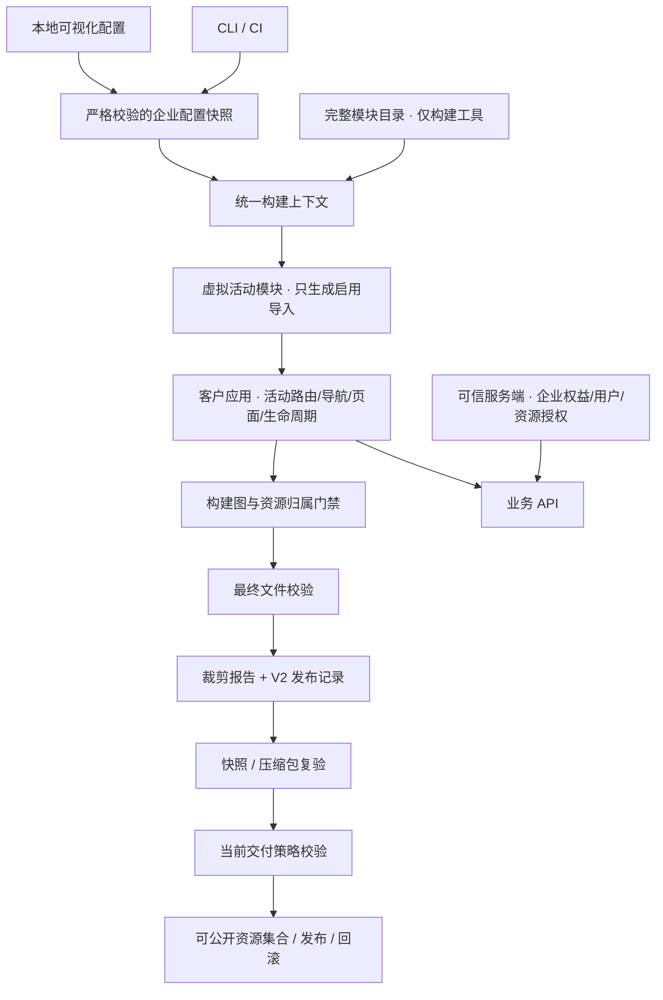

# 企业模块物理裁剪与交付校验技术方案

版本：V2 · 2026-10-15

状态：P1–P5 已实现并通过本地验收，P6 真实后端待接入。用户已确认按本方案实施；本文保留设计依据和完整验收目标，已落地接口以 README、控制台及交付操作文档为准，具体证据与生产迁移限制见[整改验证记录](pruning-verification-2026-10-15.md)。

适用项目：`enterprise-deploy`，基于提交 `04864c8` 的实现和本地风险验证结果。

本方案将企业开关的交付要求提升为：**关闭模块的业务实现及专属资源不得进入该企业交付包；开启模块继续可用；修改浏览器里的开关不能恢复包内不存在的模块。** 保留当前本地可视化配置方式、一套主干代码和按企业独立构建的流程。真实业务 API 的授权由可信服务端独立实施。

本文更新[原架构方案](architecture.md)中“代码物理裁剪初版不作保证”的边界，并补充[本地风险报告](local-risk-assessment-2026-10-15.md)提出的整改设计。原文与风险报告保留为历史依据，不改写整改前的证据。本轮已接入活动导入、裁剪门禁、V2 报告、控制台复验与目标交付策略，完成本地企业/组合矩阵和发布迁移用例；真实生产平台、CDN 与后端尚未接入。

## 1. 已确认需求与问题依据

### 1.1 已确认的产品范围

- 企业配置只管理模块开关和默认入口，沿用现有 JSON schema 与本地可视化控制台。
- 配置在构建前确定，变更后重新构建、验收、发布。
- 不新增用户角色权限配置页面，不引入客户运行时的企业开关接口。
- 企业由配置目录动态发现，继续支持 `standard`、`enterprise-a`、`enterprise-b`、`qianshi` 和后续新增企业。
- `qianshi` 当前只启用 `videoStudio`；模型广场、会话、图片生成均应从其业务交付实现中排除。

### 1.2 已验证的问题与对应设计

| 已验证的问题                                     | 当前实现原因                                                     | 本方案处理                                       |
| ------------------------------------------------ | ---------------------------------------------------------------- | ------------------------------------------------ |
| `qianshi` 仍带会话、图片生成、模型广场页面代码块 | `src/app/app.tsx` 固定声明四个动态导入，渲染前过滤不改变构建依赖 | 由构建插件只生成已启用模块的导入                 |
| 只改前端副本的布尔开关即可恢复隐藏界面           | 页面实现及完整映射已经在包内                                     | 浏览器只获得活动注册表，查不到未交付的页面加载器 |
| 只视频包仍含图片生成分支                         | `src/shared/studio-page.tsx` 同时包含图片、视频分支              | 模块业务分离，共享层只保留通用展示能力           |
| 元数据、业务数据、样式存在额外引用路径           | 完整注册表被路由等共同依赖；共享数据混放；业务样式全局导入       | 拆分构建目录与活动目录，明确代码和资源归属       |
| 浏览器测试通过但禁用代码仍在包中                 | 现有测试只验证入口、路由和请求行为                               | 增加构建图、输出文件、压缩包与发布目标校验       |
| 旧资源和旧包可能重新暴露代码                     | 部署保留跨版本 `/assets/`，回滚未验证当前模块交付上限            | 迁移公开资源集合，限制历史包发布和回滚           |

以上证据针对已交付的编译后 JavaScript。风险报告没有发现源文件或 source map 随包交付，也没有证明真实 API 越权；当前页面尚未连接业务后端。

## 2. 目标、边界与验收口径

### 2.1 必须达到的结果

1. 禁用模块的私有页面、组件、状态、接口封装、初始化逻辑、私有文案、样式和资源不进入客户构建图或输出。
2. 全部浏览器入口使用同一个活动模块集合：路由、菜单、快捷跳转、默认入口、旧路径别名、历史跳转和生命周期保持一致。
3. CLI、可视化控制台、CI 采用同一裁剪规则。发现越界依赖、来源不明资源、报告缺失或归档不一致时直接失败，不发布本次结果。
4. 裁剪结果绑定本次配置快照、构建身份和实际文件，并进入下载、归档、部署及回滚验证链路。
5. 新增模块必须显式登记归属与依赖，并更新受支持企业的完整配置；配置错误不能降级为全功能包。

### 2.2 什么可以保留

| 可以保留的内容                                      | 原因与限制                                                             |
| --------------------------------------------------- | ---------------------------------------------------------------------- |
| React、路由库、基础布局、登录和错误状态等平台能力   | 开启模块运行所需，不能夹带禁用模块业务实现                             |
| 上传、文件预览、通用输入组件                        | 会话或视频可独立需要图片上传；上传图片不等于图片生成                   |
| `ModuleId` 类型、禁用模块 ID、配置中的 `false` 字段 | 属于公开配置协议，不包含页面实现；不要求所有禁用模块名称都从字节中消失 |
| 已启用模型广场中的模型能力信息                      | 模型展示与生成体验是不同开关，沿用既有产品语义；不能带入禁用体验实现   |
| 多个开启模块共同依赖的公共库                        | 必须有实际依赖依据；不能将私有代码改名为 shared 后绕过校验             |

`qianshi` 的模型广场本身关闭，因此其模型广场私有示例数据也不应交付。不能以搜索不到 `image`、`chat` 字符串作为裁剪成功的唯一标准。

### 2.3 方案承诺的边界

本方案减少未授权模块的前端实现暴露，并阻止仅修改开关恢复随包提供的现成界面。客户能修改自己的 JavaScript，也能自行编写新的界面；已交付的任何客户端代码仍可被查看和分析。此前下载或缓存的旧代码无法从客户设备召回。

模块归属校验依赖受评审的源码边界、构建插件和可信流水线。它不能自动识别故意粘贴进公共文件的业务逻辑，也不能从任意二进制资源推导业务语义。后端授权、源码保密、制品来源可信性分别需要对应控制，不能由一个裁剪报告代替。

## 3. 总体架构



核心决策：构建层拥有完整模块知识，客户应用仅获得本次启用模块的实现与元数据。企业配置控制交付组合，当前目标的交付策略控制允许发布哪些组合，服务端策略控制真实业务请求。

## 4. 模块目录与应用装配改造

### 4.1 分离完整目录、纯算法和活动目录

拟调整的职责如下，具体文件名在实施时可按现有约定微调，但依赖方向不得改变。

| 文件 / 范围                                                                  | 拟承担职责                                                                            |
| ---------------------------------------------------------------------------- | ------------------------------------------------------------------------------------- |
| `shared/module-assembly.ts`（新增）                                          | 纯装配算法：默认入口、路由冲突、依赖满足等校验；显式接收模块集合，不导入业务模块      |
| `build/module-catalog.ts`（新增）                                            | 完整模块元数据、页面/生命周期入口的固定路径声明、模块目录归属；只供 Node 构建工具使用 |
| `build/active-modules-plugin.ts`（新增）                                     | 从统一构建上下文生成 `virtual:enterprise-modules`                                     |
| `build/build-enterprise.ts`（新增）                                          | 程序化调用 Vite 并等待构建结束，再依次生成报告、V2 记录与末次复验                     |
| `src/app/active-modules.ts`（新增）                                          | 客户应用对虚拟模块的薄适配；类型声明放入现有 Vite 类型文件                            |
| `src/app/module-registry.ts`                                                 | 移出完整注册表；纯算法移至 shared，客户装配改用活动目录                               |
| `src/app/app.tsx`                                                            | 使用活动页面加载器与活动标签/图标，删除固定四模块 lazy 表                             |
| `router.ts`、`navigation.ts`、`navigation-service.ts`、`module-lifecycle.ts` | 显式接收活动目录，去掉默认引入完整注册表的路径                                        |
| `build/validate-profiles.ts`、`console-api.ts`、`console-store.ts`           | 使用构建层完整目录，控制台继续展示全部可选模块                                        |

构建完整目录可以读取四个无副作用 `module.ts` 的元数据；它只声明业务入口路径，不导入或执行各模块页面、SDK、初始化文件。类型检查仍可检查仓库中的全部模块，不等于全部模块进入客户构建。

模块元数据拟补充独立于可选导航的页面标题和图标契约，供活动装配使用；无导航的详情模块也必须有展示信息。此改动更新 `shared/module-definition.ts` 及各模块定义，不改变企业配置协议。

### 4.2 用 Vite 虚拟模块生成启用导入

Vite 插件通过 `resolveId` / `load` 实现虚拟模块，公开 ID 使用 `virtual:`，内部 ID 使用 `\0` 前缀。本项目使用 Vite 8 / Rolldown；新增底层配置使用当前 `build.rolldownOptions`，实现以锁文件内的实际类型为准。[Vite 插件 API](https://vite.dev/guide/api-plugin.html#importing-a-virtual-file)

以 `qianshi` 为例，生成内容的形态如下；这是设计示意，不是待复制的完整实现：

```typescript
import { videoStudioModule } from '/src/modules/video-studio/module.ts';

export const activeRegistry = [videoStudioModule];
export const pageLoaders = {
  videoStudio: () => import('/src/modules/video-studio/page.tsx'),
};
export const activatorLoaders = {}; // 当前模块尚无启动器；存在时也只生成已启用入口
export const activeModuleIds = ['videoStudio'];
```

插件的约束：

- 配置对象先严格解析，再按固定目录生成导入语句；客户端提交的 ID 不能拼成任意文件路径。
- 输出只包含已启用模块的元数据、页面和显式启动器。禁止全目录 `import.meta.glob` 后在运行时过滤，也禁止兜底导入全模块映射。
- 虚拟源码存在本次 Vite 进程内，不写共享 `src/generated` 文件，避免不同企业构建互相覆盖。
- 开发服务器也使用相同的活动装配；切换配置仍需重启。开发服务器可访问源码，不能当作企业交付服务器。
- `activeRegistry` 和页面加载器的模块集合必须恰好等于配置的启用集合。启动器加载器集合必须恰好等于“已启用且在完整目录显式声明生命周期入口”的模块集合；没有启动器的模块允许缺省，禁用模块不得生成启动器加载器。

运行时查询规则调整为：

```text
可装配模块 = 活动注册表中存在对应模块与页面加载器
可进入页面 = 可装配模块 AND 构建配置启用 AND 当前用户具备页面权限
```

即使布尔开关被改成 `true`，活动注册表里仍没有禁用模块；缺少加载器时直接拒绝进入页面，不能尝试约定路径动态导入。根路径、规范路径、任务详情、旧别名和通用 playground 跳转都沿用这一集合。

### 4.3 构建上下文与并发

在 Vite 配置阶段一次确定 `buildId`、profile 快照、profileDigest、环境、所有权策略版本及摘要。保留 `APP_BUILD_ID`、CI 标识和本地 UUID 的既有来源，但将普通 CLI 的随机 ID 从发布记录生成阶段提前，供虚拟入口、报告、记录共同使用。

控制台继续使用已有 `APP_PROFILES_DIR` 配置快照和项目锁。不同企业的构建进程使用独立插件实例和输出目录；同一企业/环境的 CLI 与控制台写入必须共享输出锁，禁止仅靠控制台锁保护 CLI。新增输出锁由实际构建进程获取，与控制台父进程的项目租约分层，父子进程不能重复占有同一把锁而形成死锁。失败输出不具有有效 V2 成功记录，不能被本次任务下载或发布。固定快照始终按本次 `buildId` 校验，不能回退读取上一次成功目录。

## 5. 共享代码、样式与资源归属

### 5.1 拆分共享 Studio 业务

将 `StudioPage({ kind: 'image' | 'video' })` 拆为各模块自己的业务页面和公共表单布局：

- 图片、视频分别持有标题、提示文案、字段规则、任务参数、状态处理和未来的 API 适配器。
- 通用布局、输入组件、上传和展示组件接收明确的 props / slots，不包含按图片或视频类型选择业务的分支。
- 图片模块关闭时，其专属提示词、任务逻辑、参数校验和服务封装不应通过视频页面进入图中。
- 保留视频需要的首帧图片上传、文件预览等公共能力；公共上传组件不得反向导入图片生成模块。

### 5.2 清理数据与全局样式

把 `src/shared/model-data.ts` 的模型广场示例数据移入 `model-catalog` 私有目录；需要共用的类型留在纯契约层。App 的标签和图标从活动定义获取，避免为了显示当前标题引入完整业务数据文件。

`src/styles.css` 仅保留平台布局、基础控件与公共状态。模型广场、会话、图片、视频专属样式迁到对应模块并由模块入口导入。模块专属图标、语言包、模板、worker、WASM、字体或媒体资源采用同样规则。继续保持 `publicDir: false`、交付 `sourcemap: false`，不增加绕过模块依赖的全量静态复制。

### 5.3 归属与依赖规则

拟新增 `build/module-ownership.ts`，版本化登记模块私有根目录、平台/公共目录、构建工具目录以及确需声明的外部资源规则。第一版优先通过目录迁移表达归属，减少例外清单。

| 依赖方向                                            | 规则                                                            |
| --------------------------------------------------- | --------------------------------------------------------------- |
| 平台、公共实现 → 模块私有实现                       | 禁止；通过活动装配或纯类型契约协作                              |
| 模块 → 平台、公共实现                               | 允许，但公共实现不得隐藏另一模块业务                            |
| 模块 → 另一模块私有实现                             | 禁止直接穿透；共用代码上移，协作使用契约和活动服务提供者        |
| 模块依赖另一模块能力                                | 在 `dependsOn` 显式声明，配置必须同时启用；不自动替用户打开模块 |
| 客户应用 → 构建工具、控制台、完整目录、企业配置目录 | 禁止                                                            |
| 未知本地根目录、来源不明的虚拟实现或插件资源        | 校验失败，先补归属与评审                                        |

第三方库只随实际引用进入构建。某模块专用 SDK 应由该模块私有入口导入；仍被其他开启模块需要的通用库可以保留。插件生成、CSS 合并和资源内联必须保留归属依据，不能只看输出扩展名或文件名。

路径判定基于解析后的真实路径：统一分隔符，规范化别名、query 后缀和符号链接目标，使用目录边界匹配，防止 `?raw`、别名或软链接绕过归属。Vite 内部虚拟模块、第三方运行库和自定义插件模块分别登记处理；未知虚拟业务实现不能因没有磁盘路径而跳过检查。

## 6. 物理裁剪门禁

### 6.1 两级构建检查与文件复验

拟新增 `build/pruning-plugin.ts` 和 `build/verify-pruning.ts`，分别处理构建证据收集、统一产物验证。

| 层级         | 检查对象                                                       | 失败条件                                                                             |
| ------------ | -------------------------------------------------------------- | ------------------------------------------------------------------------------------ |
| 浏览器构建图 | 解析后的源码 ID、静态/动态依赖、资源导入和入口集合             | 禁用私有目录进入图；跨模块私有导入；构建工具或完整目录进入客户图                     |
| 最终输出     | 所有 chunk 的模块来源、导入边、CSS/资源归属、HTML 入口与预加载 | 禁用实现或专属资源被输出；悬空本地引用；未批准的外部运行时代码入口；未归属输出       |
| 磁盘与归档   | 实际目录和 `.tar.gz` 解包后的文件、大小、摘要、路径和报告      | 额外/缺失文件、旧文件混入、source map/原始源码、路径越界、链接或特殊文件、摘要不一致 |

本方案主动采用更严格的图规则：禁用模块私有实现即使最终可能被 tree shaking 删除，也不得被浏览器构建解析。Node 构建目录读取纯元数据不在该规则范围内。

最终 chunk 检查使用 Rolldown 的 `modules` / `moduleIds`、`imports` / `dynamicImports`，图检查使用 `getModuleIds` / `getModuleInfo` 等实际接口。不能把“已解析”直接解释成“已交付”，两份检查结果分别记录。[Rolldown 插件接口](https://rolldown.rs/reference/Interface.Plugin)

### 6.2 CSS、资源和插件输出的补充约束

CSS 与静态资源不能仅靠 `chunk.modules` 证明归属。实施时结合源码资源导入记录、输出资源的原始文件信息、Vite 资源关联信息及受控插件声明，建立“来源 → 使用者 → 输出”的关系。资源内联到 JS/CSS 后仍需依据原始来源检查；同一资源被合并或多处使用时记录完整来源集合。

首个实施任务必须用锁定版本做小型验证：覆盖模块 CSS、CSS `url()`、小图片内联、`?url`、worker 和插件 `emitFile`。无法完整追溯的资源不能默认算公共资源；第一版可限制该构建写法，并要求改用受控导入或显式、受评审的归属声明。对当前不存在的 WASM 等形态，使用前补齐适配和负向用例。

对输出字节追加已知私有标记、源码文件、source map、意外配置文件扫描，作为纵深检查。字符串扫描只能发现部分漏出，不能替代归属图，更不能以混淆代码通过扫描作为成功。

### 6.3 插件顺序与失败处理

- 在生成输出阶段收集与检查，发现违规调用构建错误；不采用“构建后删除几个 page 文件”的修补方式。
- 新增 `build/build-enterprise.ts` 作为最终协调器，程序化调用并 `await` Vite `build()`；所有受支持的写出和清理 hook 完成后，再顺序执行最终扫描、报告生成、V2 记录生成和末次复验。普通 `npm run build`、控制台和 CI 都经过该入口；Vite 配置与此入口复用同一个配置工厂和构建上下文，避免二次读取不同快照。
- 移除当前 `closeBundle` 中直接生成发布记录的做法。不能仅依赖 `closeBundle` 被调用就认定成功，也不能靠插件数组顺序或 `enforce: 'post'` 推断最后写出；并行 hook、失败清理和版本变化都要纳入 P0 契约验证。
- 文件摘要和报告以最终字节为准。生成记录后禁止任何插件或协调器继续修改业务文件；不支持后台异步写文件的插件，外部后改则由下载/发布复验拒绝。
- CLI 和控制台必须取得子进程退出码成功、正确构建身份、有效裁剪报告及最终文件一致性，才允许把产物作为本次成功结果。
- 门禁不提供由企业 JSON 或浏览器提交的跳过字段。直接执行 `vite build` 仍经过插件内的图/输出门禁，但未经最终协调器不生成可发布的 V2 成功记录；旧记录须在新构建前失效，发布命令必须拒绝缺少完整新记录的输出。

## 7. 裁剪报告与发布记录 V2

### 7.1 `pruning-report.json`

报告随客户包交付，至少包含下列字段。详细源码依赖图作为内部 CI 附件保存，公开报告仅包含相对路径和必要的模块归属，不包含工作机绝对路径或其他企业配置。

| 字段                                                                                 | 用途                                                                     |
| ------------------------------------------------------------------------------------ | ------------------------------------------------------------------------ |
| `schemaVersion`、`checkerVersion`、`ownershipPolicyVersion`、`ownershipPolicyDigest` | 标识报告协议、规则与实现版本                                             |
| `buildId`、`profileId`、`environment`、`profileDigest`                               | 绑定同一份构建上下文                                                     |
| `enabledModules`、`excludedModules`、`emittedModuleIds`                              | 对比声明集合、排除集合与输出业务模块集合                                 |
| `graphCheck`、`resourceCheck`                                                        | 必须为通过，报告检查范围和限制，不允许缺失时默认成功                     |
| `files[]`                                                                            | 代码、CSS、HTML、资源等实际输出的路径、大小、SHA-256、归属集合和资源类别 |

报告生成失败即构建失败。共享文件可包含多个开启模块的贡献；归属中出现任何禁用模块都失败。公共库和平台文件使用明确公共归属。未知归属不能用空数组表示通过。

### 7.2 发布记录协议升级

整改前 `release-record.json` 使用严格的 `schemaVersion: 1` 解析，不能直接追加字段。本轮新增 V2，保留现有身份、配置、源码状态、工具链、后端兼容和完整性字段，并增加：

```typescript
// V2 新增字段；解析器按 schemaVersion 严格区分 V1/V2。
pruning: {
  reportPath: 'pruning-report.json';
  reportSha256: string;
  checkerVersion: string;
  ownershipPolicyVersion: number;
  ownershipPolicyDigest: string;
}
```

生成顺序明确为：

1. 确定同一个 buildId / 配置上下文，构建代码与资源。
2. 完成裁剪检查，生成报告；报告文件清单不含报告自身和发布记录。
3. 扫描实际目录生成 V2 发布记录；其 `artifacts` 和 `artifactDigest` 覆盖业务文件与裁剪报告，继续排除发布记录自身。
4. 再次验证实际文件、报告清单、记录清单、报告摘要和身份的一致性。不存在互相包含自身摘要的循环。

`emittedModuleIds` 应与本次开启的业务模块集合一致，且路由、页面加载器齐全。最终记录的文件集合必须严格等于报告业务文件集合加报告自身；额外文件直接失败。

V1 可以被显式的历史查看路径读取并标为“未验证物理裁剪”，但新的下载任务、发布、归档和回滚链路只接受通过当前目标规则的 V2。不得给旧包补一个空报告就升级，也不得仅修改 schemaVersion；旧源码需要重新构建并经过新门禁。

### 7.3 证据的可信边界

SHA-256 能检查字节一致性，不能证明报告来自可信构建。客户或攻击者能同时改文件和自报的摘要。正式发布必须从受控 CI、受控制品库或已验证的构建来源取得包；当前本地演示部署适配器不能据此宣称具备制品签名验证。若后续接入签名/证明机制，应将其验证放在部署边界，不在浏览器里保存签名密钥。

## 8. 可视化控制台接入

保留[现有操作流程](build-console.md)：选择或新建企业 → 勾选模块与默认入口 → 保存并构建 → 预览、下载。完整模块目录仍用于配置页面；客户包只获得活动目录。企业配置的 schemaVersion 保持 1，本次无需新增用户角色配置。

构建任务状态增加可解释的阶段：配置校验 → 构建与裁剪检查 → 快照复验 → 打包复验 → 成功。构建失败显示对应模块、违规依赖或文件及修复提示，保留表单输入和日志，不提供本次下载/预览。已有成功任务仍展示其固定身份，不能冒充新任务结果。

`shared/build-console.ts` 拟在成功结果中加入受校验的裁剪摘要：检查器版本、通过状态、开启/排除模块及报告下载入口。只有统一验证器通过后才能置为通过；不能只根据配置有 `false` 或进程输出一行文字显示绿色状态。

`build/console-jobs.ts` 的成功链路调整为：

```text
固定配置快照与 job.id
  → 现有构建子进程 + 裁剪门禁
  → 常规输出的身份、V2 记录、裁剪报告与文件复验
  → 复制固定 site 快照并复验
  → 生成 tar.gz
  → 安全解包到临时目录，按同一 V2 规则复验
  → 原子发布本次成功任务结果，开放固定预览与下载
```

先列举并检查全部归档成员，再解包；拒绝绝对路径、`..`、重复路径、符号链接、硬链接及特殊文件，并限制成员数量/解包总大小、验证解包根目录。不能先解包到文件系统后才检查危险成员。压缩包不包含源码图、控制台实现或其他企业配置。控制台重启后的任务生命周期沿用既有设计，不为本次整改增加远程管理能力。

## 9. 发布、回滚与历史资源治理

### 9.1 当前交付策略独立于待发布包

在受控构建来源成立的前提下，裁剪报告及校验结果只说明包符合其声明的配置与归属规则。例如旧包自报全模块，即使裁剪正确，也不应回滚到当前仅允许视频的 `qianshi` 目标。

拟增加可信目标交付策略，与已有后端兼容声明并列管理，至少声明 `profileId`、`environment`、`allowedModules`、`minReleaseSchemaVersion`、允许的检查器/所有权规则版本或摘要。该策略由目标部署配置提供，不从待发布包或其历史 profile 推导，也不由可视化构建请求自动放宽。

发布与回滚规则：包的开启模块集合必须为目标当前 `allowedModules` 的子集，身份和环境一致，默认入口有效，裁剪证据版本被目标明确允许，同时通过现有后端兼容校验。未知字段、未知模块或过期规则均失败。策略决定模块交付上限，不充当业务 API 授权。

新增模块交付或扩大企业组合时，需在正常发布评审中明确更新目标策略。控制台仍可构建任意合法组合用于本地评估；是否允许部署由目标策略决定。第一版可以沿用本地文件适配器提供策略文件路径，生产必须通过可信部署配置保护策略来源。

### 9.2 区分私有归档与公开历史资源

当前[交付实现](delivery.md)和 Nginx 示例把旧资源保留在长期公开的 `/assets/`。新包完成裁剪后，旧包的 chat / image 文件仍可能通过原 URL 下载。仅替换 `current` 无法关闭这一暴露路径。

拟调整为：

- 历史完整制品存入受控归档，归档目录不能作为站点静态根目录或 `/assets/` 别名。
- 公开资源集合只允许来自通过当前交付策略的 V2 版本；资源名称、字节摘要和所属版本均有清单。
- 仍需支持旧标签页时，只保留同样满足当前模块上限与裁剪规则的版本资源。模块收缩后不合规的旧版本失去公开资格，其旧资源 URL 返回 404，客户端按现有加载错误状态引导刷新。
- 发布适配器在受保护的暂存目录准备新站点与允许资源集合，在目标锁内切换一致的发布指针；不能直接在正在提供服务的共享目录逐文件清理。具体指针布局需要与 Nginx 适配一起实现和验证。
- 资源被多个合规版本共用时核对同名同摘要，禁止覆盖不同字节。不能只删除文件名中带 chat / image 的资源，混合入口和共享 chunk 也可能含旧业务实现。

本次整改优先选择“模块收缩后停止提供不合规旧资源”，接受相关旧标签页需要刷新。浏览器缓存和客户已下载副本仍不能回收；实际能力关闭始终依靠服务端。

### 9.3 首次迁移步骤

1. 盘点 `dist/<企业>/<环境>`、`dist/.console`、交付包、归档、发布目录和公开缓存/CDN，标记 V1 或无裁剪证据的历史版本。
2. 对 `qianshi` 的 staging / production 及其他受支持企业重新构建，取得 V2 报告并完成验收；当前风险报告中的旧产物保持证据身份，不就地改写。
3. 将 `qianshi` 当前目标模块上限设为仅视频，所有目标启用新的记录/检查器策略。
4. 准备受控历史归档与新的公开资源集合，演练发布切换、旧 URL 失效和页面刷新；若实际使用 CDN，确认对应路径失效和源站策略，不能只处理本地目录。
5. 从公开下载入口撤下未验证旧包。没有合规历史版本时明确标记“暂无可回滚版本”，不能回滚到旧全量包兜底。
6. 保留审计记录和受控历史备份；历史目录清理作为单独运维步骤执行，实施方案不自动删除已有证据或客户资料。

## 10. 服务端授权与生产接入前置条件

前端裁剪与服务端授权并行成立。服务端从已认证上下文获取企业/用户身份，逐请求校验企业业务权益、用户权限和资源归属；不能信任浏览器传来的 profile ID、布尔开关、页面权限或可修改请求头。该原则与 [OWASP 授权建议](https://cheatsheetseries.owasp.org/cheatsheets/Authorization_Cheat_Sheet.html#validate-the-permissions-on-every-request)一致。

当前仓库没有真实业务 API，因此本次前端整改可以独立完成，但生产接入必须补齐后端提供的契约与验收：

| 待确认契约         | 必须解决的问题                                                  |
| ------------------ | --------------------------------------------------------------- |
| 身份与企业上下文   | 从哪里取得可信用户和企业，过期/退出如何处理                     |
| 企业业务能力策略   | 体验页面开关与 API 商业权益是否对应；图片上传等公共能力如何保留 |
| 生成和资源接口授权 | 创建、查询、下载、历史任务及跨企业访问逐项校验                  |
| 禁用能力的响应     | 未登录、无权限、资源不可见的状态码及前端反馈                    |
| 已运行任务和旧页面 | 模块关闭后的读取、取消、下载与刷新策略                          |

移除生产中的演示身份/管理员切换入口，并接入真实权限适配器；演示模式不能被声明为生产授权完成。现有 `demo-*.json` 后端策略仅用于兼容校验演示，不能作为 API 安全证据。本方案不编造接口地址、响应字段或声称后端已整改。

## 11. 验收设计

### 11.1 自动验收矩阵

| 范围         | 必测内容                                                                     | 通过标准                                                       |
| ------------ | ---------------------------------------------------------------------------- | -------------------------------------------------------------- |
| 现有企业     | 动态发现全部配置 × staging / production                                      | 每份真实产物通过裁剪、身份、文件和浏览器验收                   |
| 模块组合     | 当前四模块的 15 个非空组合 × 两种发布环境；依赖/默认入口不合法的组合期望失败 | 不为特定企业写裁剪特例；合法组合完整构建验证，非法组合明确拒绝 |
| 单模块重点   | video-only、image-only、chat-only、modelCatalog-only                         | 只有对应私有实现；必要共享上传可用；其他私有实现与资源不出现   |
| 已启用功能   | 页面、详情、上传、快捷入口、生命周期、错误恢复                               | 保持现有功能；真正授权接入后另测服务端拒绝                     |
| 已关闭功能   | 规范路径、旧别名、通用 playground、深链、默认回退                            | 普通用户与演示管理员都无法进入，且没有对应加载器               |
| 可视化控制台 | 真实新建/保存/快照构建、失败、冲突、下载解包、固定预览                       | 状态有据可查，失败无本次下载，包与配置及 job.id 一致           |
| 发布与回滚   | 合规 V2、不合规 V2、V1、报告缺失、规则过期、目标模块收缩                     | 不合规版本在切换前拒绝，目标目录不被部分更新                   |
| 历史资源     | 当前包、合规旧标签页、不合规旧 URL、公开下载入口                             | 公开集合只含当前策略允许的资源；缺失资源返回真实 404           |

组合构建使用临时 profile 目录，不把测试企业写入真实配置。现有企业交付矩阵继续动态发现；组合验证可放独立 CI 作业，避免在每个企业作业中重复执行。模块规模扩大后再评估矩阵抽样，不能默默删掉单模块与负向覆盖。

### 11.2 必须加入的负向用例

1. 故意让视频模块导入 chat、image 私有实现，或公共组件反向导入模块：构建必须失败，并报告可定位的依赖链。
2. 禁用模块业务入口包含构建哨兵错误：仅视频构建不应解析该入口。此用例只针对客户 bundler 图，仓库全量 typecheck 仍独立执行。
3. 图片私有 CSS、CSS URL、内联图片、worker 或插件复制资源流入仅视频输出：门禁必须发现；来源未知同样失败。
4. 用改名、混合 chunk、预加载或隐藏动态导入携带禁用代码：不能仅因文件名没有模块名称而通过。
5. 向目录或归档追加旧页面、源码、map、未知文件，或删除报告、修改摘要、换 profile/buildId：统一验证器必须拒绝。
6. 并发构建不同企业不得串配置；同企业/环境写入受锁保护。控制台快照和解包报告保持同一构建身份。
7. 将完整模块目录或控制台依赖带入客户应用：构建失败。
8. 在隔离临时产物副本中重做已验证的“仅把 false 改为 true”实验：会话、图片生成无法恢复，启用的视频仍正常。此实验用于回归现成 UI 恢复问题，不证明任意恶意修改不可行。
9. 回滚一个裁剪正确但模块集合超过当前目标上限的 V2：必须拒绝；V1 也不能通过修改版本号获得发布资格。
10. 发布模块收缩版本后，请求旧的混合入口与禁用页面 URL：不能继续从历史公开资源仓库取回；无合规旧包时回滚命令明确失败。

### 11.3 拟新增的验证入口

以下验证入口已接入本轮实现，完整矩阵与失败注入结果仍需纳入最终验收：

```bash
# 普通 build 成功前自动完成门禁，无需用户手工开启
APP_PROFILE=qianshi npm run build -- --mode production

# 对指定目录独立核对 V2 记录、报告与实际文件
npm run pruning:verify -- --artifact dist/qianshi/production

# 临时配置组合、资源归属与失败注入验证
npm run test:pruning
```

现有 `release:verify / archive / deploy / rollback` 接入同一个产物验证器并增加可信交付策略输入；独立 `pruning:verify` 只验证包内一致性，不代替目标策略、真实后端授权或来源验证。CI 只上传通过末次校验的成功产物，详细图和失败原因作为内部诊断材料保留。

## 12. 实施拆分与完成条件

| 阶段              | 主要交付                                                  | 依赖                   | 完成条件                                                                 |
| ----------------- | --------------------------------------------------------- | ---------------------- | ------------------------------------------------------------------------ |
| P0 构建接口验证   | 锁定 Vite/Rolldown 的资源追溯验证、归属规则、报告/V2 契约 | 本方案评审             | CSS、内联资源、worker、插件输出均有可验证规则；不支持形态明确拒绝        |
| P1 活动装配       | 纯算法、Node 完整目录、虚拟模块、所有浏览器调用点迁移     | P0                     | 仅视频入口不引用其他模块；路由/导航/生命周期一致；控制台仍可配置全部模块 |
| P2 业务与资源拆分 | Studio、模型数据、模块样式与私有资源整理                  | P1                     | 单模块构建不存在另一模块业务分支；公共上传功能保留                       |
| P3 门禁与证据     | 图/资源/输出校验、报告、V2 记录、统一验证器               | P0–P2                  | 负向依赖和资源泄漏失败；最终文件与报告绑定；失败无有效成功记录           |
| P4 控制台与流水线 | 真实阶段反馈、快照/tar 复验、输出锁、组合 CI              | P3                     | CLI/控制台/CI 同一规则；成功包可追溯；并发、失败与冲突验证通过           |
| P5 发布迁移       | 可信交付策略、V1 阻断、公开资源集合、回滚约束、文档更新   | P3–P4                  | `qianshi` 两环境重建通过；旧公开资源治理演练通过；无不合规回滚路径       |
| P6 真实业务接入   | 身份/权限/API 契约与服务端逐请求授权                      | 后端及部署平台提供契约 | 禁用能力、跨企业资源、伪造前端开关请求均按可信策略拒绝                   |

P1–P5 完成后才可宣布“企业构建支持物理裁剪并通过交付验收”；P6 完成后才能针对真实业务声明服务端授权已验证。单纯隐藏菜单、生成虚拟入口或展示报告，均不能单独作为整体完成依据。

实施时更新 README、[控制台说明](build-console.md)、[交付说明](delivery.md)中的现状、命令和历史资源策略；保留原风险报告作为已发现问题的证据，并另写整改验证结果，不改写原始审计结论。

## 13. 实施与验收检查点

用户已确认按本方案实施。下列取舍作为实现评审与最终验收依据；当前前端与交付整改不编造真实后端接口：

- 对物理裁剪采用严格构建图规则，禁用私有实现连被浏览器 bundler 解析也不允许。
- 资源来源无法证明时失败，由受控写法/归属声明补齐，不默认归为 shared。
- 新交付链路要求 V2，历史 V1 只保留受控查看与证据用途，重新构建后才能发布。
- 回滚遵循当前目标模块上限；模块收缩后允许旧标签页因资源失效而要求刷新。
- 第一轮范围为本仓库构建、控制台、CI 和本地部署适配器；真实部署平台、CDN 与后端契约按实际环境接入。

P1–P5 已通过本地验收，企业/组合矩阵、负向用例、固定包与发布迁移证据见[整改验证记录](pruning-verification-2026-10-15.md)。真实站点仍需采用新的静态资源配置并验收 CDN，P6 真实后端待接入，不能把前端裁剪或演示权限测试表述为生产服务端授权已经完成。
