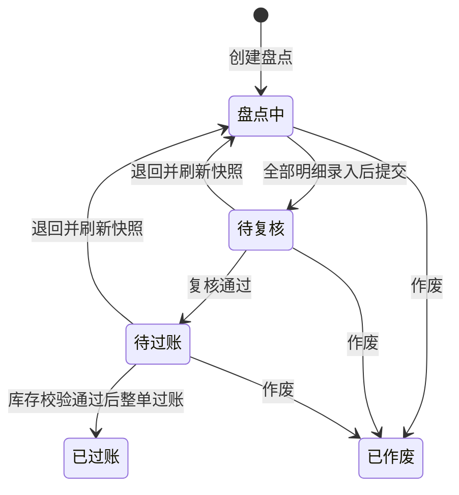

# 细粒度功能模块

当前目录表包含 **120 个独立裁剪单元**：12 个业务模块、49 个按钮与操作、25 个表单字段、15 个表格列、9 个详情页签、10 个共享 Mock 资源。新增 44 项外部资源场景的完整清单与全量 / 定制对照见 [外部资源 Mock 与定制规则](external-resources.md)。企业 A 默认全部启用，企业 B 仅启用 `orders`，用于验证零列扩展的最小订单页面。字段、列、页签与操作都使用同一份 `enabledModules` 白名单，各自拥有源码归属根、权限、依赖与构建来源证据。

所有业务数据均为本地演示数据，页面切换保留本次会话，刷新浏览器重置。字段与列的裁剪控制前端呈现及实现交付；真实接口的数据返回和字段访问权限仍由服务端约束。

## 独立配置清单

控制台先按订单、库存、盘点、审批、报表和审计分组，操作和对应字段放在同一子组，详情与列表各自管理。整组启用、关闭与补齐依赖先预览影响再应用到草稿。控制台支持名称 / 描述 / ID 搜索、已启用 / 未启用筛选，以及「业务模块、按钮与操作、表单字段、表格列、详情页签」类型筛选。过滤只改变展示，不丢失已经选择的能力。

### 业务模块

| ID          | 能力     | 显式依赖 | 权限             | 普通成员 |
| ----------- | -------- | -------- | ---------------- | -------- |
| `orders`    | 订单管理 | 无       | `order.read`     | 允许     |
| `reports`   | 经营报表 | 无       | `report.read`    | 无       |
| `inventory` | 库存管理 | 无       | `inventory.read` | 允许     |
| `approvals` | 审批中心 | 无       | `approval.read`  | 允许     |
| `audit-log` | 操作审计 | 无       | `audit.read`     | 无       |

### 按钮与操作

| ID                    | 能力     | 显式依赖                                                                                 | 权限                 | 普通成员 |
| --------------------- | -------- | ---------------------------------------------------------------------------------------- | -------------------- | -------- |
| `order-export`        | 订单导出 | `orders`                                                                                 | `order.export`       | 无       |
| `order-create`        | 新建订单 | `orders`、`order-field-customer`、`order-field-amount`                                   | `order.create`       | 无       |
| `order-bulk-complete` | 批量完成 | `orders`                                                                                 | `order.complete`     | 无       |
| `order-priority`      | 订单加急 | `orders`                                                                                 | `order.priority`     | 无       |
| `order-detail`        | 订单详情 | `orders`                                                                                 | `order.detail`       | 允许     |
| `inventory-adjust`    | 库存调整 | `inventory`                                                                              | `inventory.adjust`   | 无       |
| `inventory-transfer`  | 库存调拨 | `inventory`                                                                              | `inventory.transfer` | 无       |
| `approval-submit`     | 发起审批 | `approvals`、`approval-field-title`、`approval-field-applicant`、`approval-field-amount` | `approval.submit`    | 允许     |
| `approval-approve`    | 审批通过 | `approvals`                                                                              | `approval.approve`   | 无       |
| `approval-reject`     | 审批驳回 | `approvals`                                                                              | `approval.reject`    | 无       |
| `approval-review`     | 审批复核 | `approvals`                                                                              | `approval.review`    | 无       |
| `approval-detail`     | 审批详情 | `approvals`                                                                              | `approval.detail`    | 允许     |

### 表单字段

| ID                                  | 能力           | 显式依赖                                       | 权限              | 普通成员 |
| ----------------------------------- | -------------- | ---------------------------------------------- | ----------------- | -------- |
| `order-field-customer`              | 客户名称字段   | `orders`                                       | `customer.edit`   | 无       |
| `order-field-amount`                | 订单金额字段   | `orders`                                       | `amount.edit`     | 无       |
| `order-field-reference`             | 客户参考号字段 | `order-create`                                 | `reference.edit`  | 无       |
| `approval-field-title`              | 申请事由字段   | `approvals`                                    | `title.edit`      | 允许     |
| `approval-field-applicant`          | 申请人字段     | `approvals`                                    | `applicant.edit`  | 允许     |
| `approval-field-amount`             | 申请金额字段   | `approvals`                                    | `amount.edit`     | 允许     |
| `approval-field-cost-center`        | 成本中心字段   | `approval-submit`                              | `costCenter.edit` | 无       |
| `approval-field-urgency`            | 紧急程度字段   | `approval-submit`                              | `urgency.edit`    | 允许     |
| `inventory-adjust-field-quantity`   | 调整数量字段   | `inventory`                                    | `delta.edit`      | 无       |
| `inventory-adjust-field-reason`     | 调整原因字段   | `inventory`                                    | `reason.edit`     | 无       |
| `inventory-transfer-field-source`   | 源仓商品字段   | `inventory`                                    | `sourceId.edit`   | 无       |
| `inventory-transfer-field-target`   | 目标仓字段     | `inventory`、`inventory-transfer-field-source` | `targetId.edit`   | 无       |
| `inventory-transfer-field-quantity` | 调拨数量字段   | `inventory`                                    | `quantity.edit`   | 无       |
| `inventory-transfer-field-reason`   | 调拨原因字段   | `inventory`                                    | `reason.edit`     | 无       |
| `approval-approve-field-comment`    | 初审意见字段   | `approval-approve`                             | `comment.edit`    | 无       |
| `approval-reject-field-reason`      | 驳回原因字段   | `approvals`                                    | `comment.edit`    | 无       |
| `approval-review-field-comment`     | 复核意见字段   | `approval-review`                              | `comment.edit`    | 无       |

### 表格列

| ID                           | 能力                   | 显式依赖    | 权限          | 普通成员 |
| ---------------------------- | ---------------------- | ----------- | ------------- | -------- |
| `order-column-customer`      | 订单 · 客户列          | `orders`    | `column.read` | 允许     |
| `order-column-amount`        | 订单 · 订单金额列      | `orders`    | `column.read` | 允许     |
| `order-column-status`        | 订单 · 状态列          | `orders`    | `column.read` | 允许     |
| `approval-column-title`      | 审批 · 申请事由列      | `approvals` | `column.read` | 允许     |
| `approval-column-applicant`  | 审批 · 申请人列        | `approvals` | `column.read` | 允许     |
| `approval-column-amount`     | 审批 · 金额列          | `approvals` | `column.read` | 允许     |
| `approval-column-status`     | 审批 · 状态列          | `approvals` | `column.read` | 允许     |
| `inventory-column-quantity`  | 库存 · 实存列          | `inventory` | `column.read` | 允许     |
| `inventory-column-reserved`  | 库存 · 预留列          | `inventory` | `column.read` | 允许     |
| `inventory-column-available` | 库存 · 可用 / 预警线列 | `inventory` | `column.read` | 允许     |
| `inventory-column-status`    | 库存 · 状态列          | `inventory` | `column.read` | 允许     |

### 详情页签

| ID                         | 能力                | 显式依赖          | 权限               | 普通成员 |
| -------------------------- | ------------------- | ----------------- | ------------------ | -------- |
| `order-notes`              | 订单备注            | `order-detail`    | `order.note`       | 无       |
| `approval-history`         | 审批记录            | `approval-detail` | `approval.history` | 允许     |
| `order-detail-overview`    | 订单 · 基本信息页签 | `order-detail`    | `tab.read`         | 允许     |
| `approval-detail-overview` | 审批 · 申请信息页签 | `approval-detail` | `tab.read`         | 允许     |
| `order-detail-extra`       | 订单 · 扩展信息页签 | `order-detail`    | `tab.read`         | 无       |
| `approval-detail-extra`    | 审批 · 扩展信息页签 | `approval-detail` | `tab.read`         | 无       |

## 新手指引

`onboarding` 是独立操作能力，无业务模块依赖，权限为 `guide.read`，管理员与普通成员可用。企业 A 默认启用，企业 B 默认不安装。控制台中可在「新手指引」分组单独选择；不安装时指引组件和专属样式不进入客户产物。

菜单通过 `MenuItem.guide` 提供说明和顺序，工具栏按钮通过 `OrderTool.guide` 提供页面、标题与说明。指引仅收集当前许可与权限允许的菜单和按钮，不在公共组件里维护全量业务文案。点击下一步进入对应页面，高亮实际菜单或按钮。缺少定位目标时支持重试或跳过。

完整行为、存储范围和扩展方式见 [新手指引](onboarding.md)。

## 库存盘点（新增 24 项）

盘点页面路径为 `/stocktakes`。本模块默认没有预置盘点单，创建时固定指定仓库全部商品的账面数量、预留数量和库存版本。

| 能力 ID                            | 用途                               | 必需依赖                         |
| ---------------------------------- | ---------------------------------- | -------------------------------- |
| `stocktakes`                       | 库存盘点页面与会话数据             | `inventory`                      |
| `stocktake-create`                 | 创建盘点                           | `stocktakes`、名称字段、仓库字段 |
| `stocktake-count`                  | 逐项录入 / 修改实盘                | 明细页签、数量字段、差异原因字段 |
| `stocktake-submit`                 | 提交复核                           | `stocktakes`                     |
| `stocktake-approve`                | 复核通过                           | `stocktakes`                     |
| `stocktake-return`                 | 退回重盘                           | `stocktakes`、重盘原因字段       |
| `stocktake-post`                   | 差异过账                           | `stocktakes`                     |
| `stocktake-cancel`                 | 作废盘点                           | `stocktakes`、作废原因字段       |
| `stocktake-detail`                 | 盘点详情入口                       | `stocktakes`                     |
| `stocktake-create-field-title`     | 盘点名称，1–80 字                  | `stocktakes`                     |
| `stocktake-create-field-warehouse` | 从当前库存选择盘点仓库             | `stocktakes`                     |
| `stocktake-create-field-note`      | 可选备注，最多 200 字              | `stocktake-create`               |
| `stocktake-count-field-quantity`   | 实盘数，0–100 万的整数             | `stocktakes`                     |
| `stocktake-count-field-reason`     | 实盘数与账面数不同时必填，1–200 字 | `stocktakes`、实盘数量字段       |
| `stocktake-return-field-reason`    | 重盘原因，1–200 字                 | `stocktakes`                     |
| `stocktake-cancel-field-reason`    | 作废原因，1–200 字                 | `stocktakes`                     |
| `stocktake-approve-field-comment`  | 可选复核意见，最多 200 字          | `stocktake-approve`              |
| `stocktake-column-warehouse`       | 仓库列                             | `stocktakes`                     |
| `stocktake-column-progress`        | 已盘 / 总项数列                    | `stocktakes`                     |
| `stocktake-column-difference`      | 净差异列；未盘完时不展示部分总数   | `stocktakes`                     |
| `stocktake-column-status`          | 状态列                             | `stocktakes`                     |
| `stocktake-detail-lines`           | 明细页签，承载行内录入扩展         | `stocktake-detail`               |
| `stocktake-detail-history`         | 流转记录页签                       | `stocktake-detail`               |
| `stocktake-detail-extra`           | 扩展信息页签                       | `stocktake-detail`               |



- 同仓最多一张未结束盘点单；其他仓可独立建单。盘点中的明细允许保存实盘数，`null` 表示未盘，`0` 是合法实盘数。有差异必须填写原因，修改实盘数会清空之前的原因。
- 提交校验所有明细后锁定录入。通过与提交各自独立配置；裁掉后续能力不会跳过业务状态。未装配复核意见字段时使用默认记录，字段数据不进入提交值。
- 过账在准备任何新库存集合前核验全部明细：商品范围、SKU、仓库、数量、预留量、版本必须与快照一致，实盘数不能低于当前预留量。任意失败保持整单和全部库存不变。
- 库存调整、调拨、盘点过账都会推进库存版本；即使数量先变化又恢复，旧快照仍不能过账。成功后进入终态，重复过账及作废均被拒绝。
- 退回可处理待复核和待过账单据，按当前仓库全部商品刷新快照，清空实盘数和差异原因，保留历史记录。没有退回能力的企业可由已安装的其他流程结束当前单据，前端不静默增加操作。
- 普通成员只读盘点列表、列、详情页签；所有变更动作及字段默认仅管理员可用。动作权限在提交时再次校验。实现仍为会话内演示，真实并发事务与人员职责分离需由后端实现。

## 审批操作规则

- `approval-approve` 只处理「待审批」。金额小于 ¥50,000 时进入「已通过」；达到阈值时进入「复核中」。
- `approval-review` 只处理「复核中」，成功后进入「已通过」。它不依赖通过能力，可以单独交付给只做复核的企业版本。
- `approval-reject` 独立处理「待审批」和「复核中」，原因必填；终态不能再次操作。
- 三个能力各有独立入口、确认表单、状态变更函数和权限。任何一个都不会导入另外两个能力的实现。
- 未启用复核能力时，大额初审仍进入「复核中」，不会改成直接通过。未启用驳回能力时不展示驳回按钮和原因输入框。
- 普通成员可以发起、查看申请及已授权的页签，不能执行这三个决策动作。演示管理员可以完成两步；真实多人身份分离需要接入服务端审批规则。

## 表单字段规则

`order-create` 的客户名称、订单金额与 `approval-submit` 的申请事由、申请人、申请金额均已迁移为独立字段能力。这五个是现有业务契约的必填输入，提交能力显式依赖相应字段。尝试保留提交能力却裁掉必填字段，会在控制台、配置校验及构建端被拒绝，不以空字符串或默认金额补齐。

三个可选扩展字段可以单独启停：

| 字段       | 表单     | 校验与默认行为                                       |
| ---------- | -------- | ---------------------------------------------------- |
| 客户参考号 | 新建订单 | 可留空，非空时限 1–40 位字母、数字和短横线           |
| 成本中心   | 发起审批 | 可留空，非空时为 `RD-001` 形式；演示中仅管理员可填写 |
| 紧急程度   | 发起审批 | 普通 / 紧急，默认普通，普通成员也可填写              |

字段定义、标题、选项与 `parse` 校验器位于对应 owner 内。共享表单只负责通用控件渲染；提交时重新计算当前许可和用户权限的交集，只序列化仍可用的字段。未注册字段、被撤销权限的字段和旧草稿都不会进入提交结果。可选空字段不写入扩展信息。

校验失败保留其他输入；成功后清空草稿。多数操作取消后重新打开保留尚未提交的内容；逐行实盘编辑每次打开使用该行已保存的实盘记录，取消时放弃这次行编辑。许可或身份改变时，撤销字段立即从草稿移除，重新获得权限也不恢复旧值。必填字段不可用时禁用提交并显示原因。

库存调整、调拨、审批通过、驳回、复核也已全部使用独立字段能力。加上盘点后共 12 个表单目标、25 个独立字段能力，其中 18 个是操作必需字段（盘点差异原因为条件必填），7 个可选扩展字段。库存与审批操作规则如下。

| 操作     | 字段能力                            | 必填与边界                                              |
| -------- | ----------------------------------- | ------------------------------------------------------- |
| 库存调整 | `inventory-adjust-field-quantity`   | 非零整数，绝对值不超过 100 万；调整后不得低于已预留库存 |
| 库存调整 | `inventory-adjust-field-reason`     | 去空白后 1–200 字                                       |
| 库存调拨 | `inventory-transfer-field-source`   | 必须为当前库存台账中的源仓商品                          |
| 库存调拨 | `inventory-transfer-field-target`   | 必须为同 SKU 的其他仓库；同时依赖源仓字段               |
| 库存调拨 | `inventory-transfer-field-quantity` | 1–100 万的整数，且不超过源仓可用量                      |
| 库存调拨 | `inventory-transfer-field-reason`   | 去空白后 1–200 字                                       |
| 审批通过 | `approval-approve-field-comment`    | 可选，去空白后最多 200 字                               |
| 审批驳回 | `approval-reject-field-reason`      | 必填，去空白后 1–200 字                                 |
| 审批复核 | `approval-review-field-comment`     | 可选，去空白后最多 200 字                               |

库存调整依赖数量、原因字段；调拨依赖源仓、目标仓、数量、原因字段；驳回依赖驳回原因字段。目录表在构建前检查完整依赖，不能通过隐藏必填输入来绕过规则。

初审意见与复核意见是两个独立的可选能力，分别依赖自身操作。关闭它们后，确认流程仍可完成，审批记录使用已有默认意见「同意申请」。这两项的标题、输入配置和 200 字校验器完全位于各自 owner 内，操作模型不再保留这部分输入校验代码。空白意见也按默认意见处理。

源仓与目标仓字段各自拥有动态选项工厂。切换源仓会按字段声明的 `dependsOn` 清空目标仓，保留数量和原因；目标选项仅包含同商品的其他仓库。没有源仓或没有合适目标时禁用目标控件与提交按钮，并展示原因。提交时再次检查当前台账，拒绝失效或跨 SKU 的选择；所有验证通过后才原子更新两端库存。

共享字段控件只消费通用的动态选项、禁用、提示和依赖声明，不硬编码仓库规则。装配阶段拒绝字段依赖缺失与循环；运行时必填字段被撤销许可时清除对应草稿并禁用提交，可选意见被撤销后也不会继续提交旧值。

## 表格列规则

订单的客户、金额、状态三列；审批的事由、申请人、金额、状态四列；库存的实存、预留、可用量 / 预警线、状态四列；盘点的仓库、进度、净差异、状态四列均为独立列能力。各列标题、单元格组件及格式化逻辑随 owner 一起装配和裁剪。表头与单元格使用同一份授权列清单，保证列数、顺序一致。

选择框、记录编号、商品 / 仓库定位信息，以及已有操作扩展的容器属于宿主结构。没有配置任何业务列时，页面仍保留最小定位与操作能力。仅裁掉金额列不会改变订单或审批金额本身，也不会改变审批阈值、汇总统计或其他已交付页面。

## 详情页签规则

`order-detail`、`approval-detail` 与 `stocktake-detail` 是详情弹窗入口，仅消费通用页签容器，不直接引用具体页签。订单支持基本信息、跟进备注、扩展信息；审批支持申请信息、审批记录、扩展信息。备注和审批历史已经迁移到页签，沿用原能力 ID。

- 未启用的页签没有标题、内容组件和专属实现；未配置任何页签时显示明确空态。
- 页签内容首次选中才加载；切换后保留已访问面板的草稿。
- 许可或身份撤销当前页签时，删除相关内容与草稿，回退到第一个可用页签，并在需要时恢复键盘焦点。
- 支持 `tablist` / `tab` / `tabpanel` 语义、左右方向键、Home / End、Escape 关闭与触发按钮焦点恢复。
- 扩展信息展示已成功提交的可选字段。演示中这两个扩展信息页签仅管理员可见，申请历史与普通信息可单独授权。

## 企业配置示例

只交付审批初审、状态列与申请信息页签，不包含驳回、复核、其他列和审批记录：

```json
{
  "schemaVersion": 1,
  "enterpriseId": "approval-initial",
  "enabledModules": [
    "approvals",
    "approval-approve",
    "approval-column-status",
    "approval-detail",
    "approval-detail-overview"
  ],
  "brandingId": "brand-a"
}
```

增加审批发起并启用紧急程度字段时，在上述清单内显式追加 `approval-submit`、`approval-field-title`、`approval-field-applicant`、`approval-field-amount` 和 `approval-field-urgency`。成本中心、驳回、复核与历史不会被自动补开。

订单只启用备注页签时需要 `orders`、`order-detail`、`order-notes`；它不会隐式带入 `order-detail-overview`。只读库存可以选择 `inventory` 加任意库存列，无需交付调整与调拨能力。

## 从上一版迁移

- `approval-decide` 已拆除。需要延续全部决策能力的企业，显式替换成 `approval-approve`、`approval-reject`、`approval-review`；按需要更新交付目标的模块上限。
- `approval-history` 现在是详情页签，依赖 `approval-detail`，不再自带行内入口；申请信息页签需要另选 `approval-detail-overview`。
- `order-notes` 现在是备注页签，基础信息页签需要另选 `order-detail-overview`。
- `order-create`、`approval-submit`、`inventory-adjust`、`inventory-transfer` 和 `approval-reject` 需要显式追加各自必填字段依赖；列表原有业务列需要逐项启用。
- 从 42 项配置迁移时，库存调整新增 2 项字段依赖，调拨新增 4 项，驳回新增 1 项。要保留初审和复核的意见输入，分别追加两个可选意见字段。
- 企业 A 清单与发布目标已完成迁移，企业 B 保持仅基础订单。
- 未识别旧能力或缺失依赖时继续拒绝构建，不做可能扩大权限的兼容兜底。历史制品仍按原有策略摘要复验。

## 实现与验证入口

- `src/contracts/presentation.ts`：字段、列、页签契约与扩展表单数据。
- `src/composition/assemble.ts`：全局扩展 ID 冲突、字段 target / key 冲突、目标校验、稳定排序与权限声明。
- `src/shared/ConfiguredFields.vue`、`useConfiguredForm.ts`、`form.ts`：通用字段渲染、草稿生命周期和授权后序列化。
- `src/shared/useColumns.ts`、`DetailTabs.vue`：授权列与按需详情页签。
- `tests/architecture/action-fields.test.ts`：五个操作的必填规则、动态选项、依赖清空、撤销字段许可、可选意见默认值和字段依赖环。
- `tests/architecture/presentation.test.ts`：独立审批阶段、字段校验与剔除、权限撤销、跨类型冲突与排序。
- `tests/architecture/build.test.ts`：A/B 并行构建与单独通过 / 驳回 / 复核、单列、必填字段、无页签等生产组合，校验业务 owner 与最终字节。
- `tests/e2e/action-fields.spec.ts`：生产制品中的调拨联动、调整必填校验、取消后草稿恢复、无意见初审 / 复核、身份撤销与 390px 窄屏。
- `tests/e2e/granular.spec.ts`：隔离精简企业的生产制品，验证操作缺失、字段 / 列 / 页签裁剪、阈值保留、页签懒加载、草稿恢复和 390px 布局。
- `tests/console/browser.spec.ts`：能力类型筛选、独立按钮选择、必填字段和页签依赖、配置保存。

运行 `npm run check`、`npm run test:e2e`、`npm run test:console`。浏览器测试的精简企业创建在临时项目里，不改动实际企业配置。截图输出到 `test-results/`。

本轮验证记录见 [2026-10-25 库存盘点与模块化控制台验证](verification-2026-10-25.md)。上一轮记录保留在 [2026-10-24 操作字段裁剪验证](verification-2026-10-24.md)。
