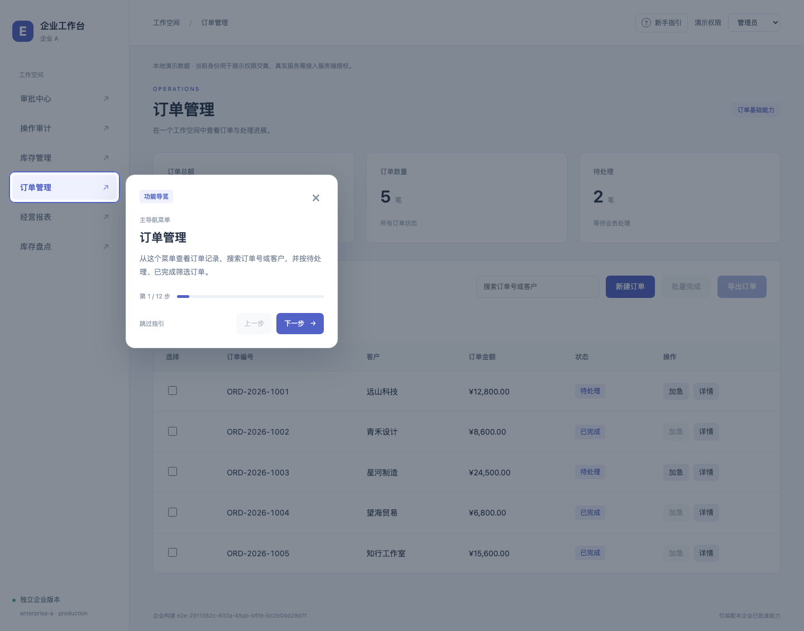
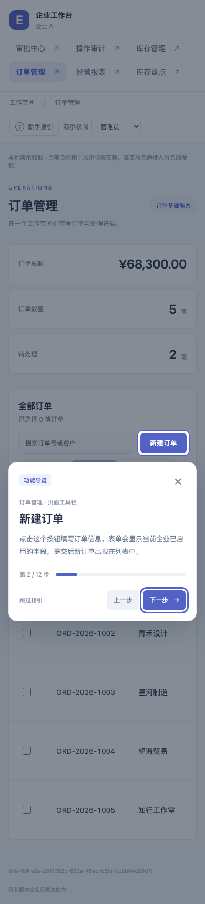

# 新手指引

业务工作台和企业打包控制台都提供分步骤的功能导览。首次访问显示欢迎弹窗，用户点击「开始了解」后，高亮实际菜单或按钮，并说明点击位置、用途与使用条件。

## 使用方式

- 首次进入选择「开始了解」或「稍后再说」。导览中支持上一步、下一步、跳过和关闭，最后一步显示「完成指引」。
- 右上角「新手指引」可随时重新查看。跳过、关闭或完成后刷新不再自动弹出。
- 业务导览会进入对应页面再定位，顺序为订单、库存、盘点、审批、报表和审计，各模块后接当前可用的常用工具栏按钮。导览不会点击业务提交按钮。
- 企业 A 管理员为 12 步；普通成员为 5 步。精简测试企业只介绍已装配的 7 个位置。没有许可或权限的菜单与按钮不生成说明。
- 控制台为 7 步：企业、品牌与环境、模块、能力与依赖、交付摘要、保存与打包、构建结果。导览不会保存配置、改变模块选择或启动构建。



## 权限、配置和记忆

业务指引能力 ID 为 `onboarding`，独立源码目录为 `src/modules/onboarding`，无必需业务模块依赖。它向 `shellTools` 扩展点贡献右上角入口，管理员与普通成员的权限为 `guide.read`。企业 A 默认启用，企业 B 不安装。控制台自身的指引属于开发工具，不由企业客户清单控制。

每一步由所属菜单或按钮声明，运行时再次取企业许可和当前权限的交集。切换身份或撤销能力时，正在查看的无权步骤会移除，并定位到可用步骤；没有任何可用步骤时关闭指引。无权限身份不显示业务指引入口。

浏览器记忆使用 `localStorage`：业务键为 `enterprise:guide:v1:<enterpriseId>`，控制台键为 `enterprise:guide:v1:build-console`。业务按企业隔离，控制台单独记录，刷新和重启不重复欢迎。真实账号接入后可将业务键扩展为账号与企业组合，或由服务端存储指引状态。浏览器禁止存储时当前访问仍能使用与关闭指引，刷新后可能再次显示欢迎。

## 定位与可访问性

使用原生模态 `dialog` 管理焦点与背景交互。支持 Tab 键在指引内移动，方向键切换步骤，Escape 退出；关闭后恢复到启动入口或此前可用焦点。

指引通过 `data-guide` 锚点定位，不通过按钮文案查找节点。进入页面后等待异步按钮渲染，定位超时展示重新定位和继续查看入口。滚动与窗口尺寸变化后重新计算目标框和说明卡片位置；适配 390px 和较短视口。异步定位、观察器和事件监听在步骤切换、关闭和卸载时清理，避免旧任务覆盖当前步骤。



## 添加新说明

在菜单所属模块的 `index.ts` 中声明：

```ts
guide: {
  order: 10,
  description: '从这个菜单查看列表并使用搜索与筛选。',
}
```

在工具栏能力中声明说明，并在实际按钮上添加与贡献 ID 对应的锚点：

```ts
guide: {
  routeName: 'orders',
  title: '新建订单',
  description: '点击这里填写订单信息并提交。',
}
```

```html
<button data-guide="tool:order-create">新建订单</button>
```

菜单锚点由工作台统一生成。装配时校验说明文本、顺序和工具目标页面；业务模块无需导入指引实现。关闭业务能力后，其专属说明随对应 owner 裁剪。关闭 `onboarding` 后，共享导览组件没有客户入口引用，不进入该客户的交付图与文件。

## 验证

2026-10-26 新增 5 条架构单元测试、7 条业务浏览器测试和 2 条控制台浏览器测试，覆盖稳定顺序、安装与权限交集、无效元数据、位置计算、首次弹出、记忆与重开、全部步骤、权限变化、目标缺失恢复、禁用浏览器存储、390px 和焦点恢复。

构建组合包含 `orders` 与 `orders + onboarding`，同时检查业务 owner 和最终 JavaScript 中的「正在定位功能位置…」标记，确认指引随企业白名单裁剪。业务企业 B 验证没有指引入口和相关分块请求。
