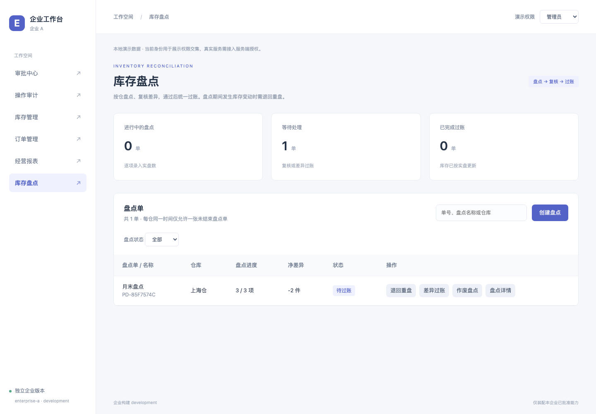

# 2026-10-25 库存盘点与模块化控制台验证

本轮新增 24 项库存盘点能力，总计 75 项独立裁剪能力：6 个业务模块、20 个按钮与操作、25 个字段、15 个表格列、9 个详情页签。企业 A 启用全部，企业 B 仍只交付订单基础模块。

## 检查结果

| 检查                      | 结果                          | 主要覆盖                                                                 |
| ------------------------- | ----------------------------- | ------------------------------------------------------------------------ |
| `npm run check`           | 115 / 115 测试通过，10 个文件 | 格式、严格类型、源码边界、生产构建图、包内字节、业务状态规则、控制台 API |
| `npm run test:e2e`        | 27 / 27 通过                  | 封包后的生产站点，含 5 条盘点场景                                        |
| `npm run test:console`    | 10 / 10 通过                  | 模块导航、筛选、依赖定位、批量变更预览、真实打包下载、并发修改、移动端   |
| 最终类型 / 格式与差异检查 | 通过                          | `npm run typecheck`、`npm run format:check`、`git diff --check`          |

## 盘点业务

- 创建时固定仓库全部商品的数量、预留量和版本快照；同仓未结束盘点阻止重复建单，不影响其他仓。
- 未盘数量使用 `null`，`0` 是有效输入。有差异时必须说明原因；空白原因和小数、负数、超界数量被拒绝。
- 全部明细录入后才能提交复核，提交后不能修改实盘。复核通过仅进入待过账，过账为另一项独立能力。
- 整单过账验证全部商品范围、身份、数量、预留量、库存版本；后续某一行失败时，前面所有行也不更新。
- 调整、调拨、过账推进库存版本。数量变化后再恢复仍不能用旧快照过账，覆盖了 ABA 变化场景。
- 退回重盘更新快照、清空全部实盘与原因、保留历史；作废保留记录且不改库存，终态禁止重复操作。
- 生产浏览器走通盘点、实盘录入、提交、复核、过账、审计查询；验证库存冲突、退回、重复建单、权限撤销、390px 嵌套弹窗与 Escape 焦点恢复。

## 模块化控制台

- 6 个业务模块导航，模块内部按操作分组，字段紧跟所属操作，列和详情单独管理。
- 搜索与类型 / 选择状态筛选保留草稿，筛选下的分组仍可折叠。依赖按钮可切换模块、展开对应分组并聚焦目标能力。
- 整组启用先预览完整依赖闭包；关闭先预览所有已选反向依赖。启用整组盘点显示 24 项盘点能力及 1 项库存基础依赖，关闭库存会列出受影响的盘点能力。取消不改变配置。
- 补齐必需依赖不会启用无关操作或可选意见。单项勾选仍由用户选择，依赖缺失阻止保存与打包。
- 交付摘要及构建结果按模块折叠；实际打包结果绑定固定配置，继续支持下载、复验与预览。
- 模块分组元数据只用于构建控制台，不改变各能力的源码 owner 或生成的静态注册表。

## 裁剪证据

`tests/architecture/build.test.ts` 新增基础盘点、创建盘点、仅录入、仅过账、仅复核，以及可选备注 / 复核意见开关的独立生产组合。所有组合同时检查构建图与输出文件的业务来源均在允许清单内。

最终 JavaScript 还检查以下专属文案是否随对应能力出现或消失：

- `stocktake-create-field-note`：盘点备注须为不超过 200 字的文本。
- `stocktake-approve-field-comment`：盘点复核说明最多输入 200 字。
- `stocktake-post`：只有复核通过的盘点单可以差异过账。
- `stocktake-count-field-reason`：实盘数与账面数不同，必须说明差异原因。

精简企业在临时项目里构建、封包、复验并运行：保留创建、录入、提交和复核，排除过账、退回、作废、可选备注 / 意见、扩展页签和其他盘点列。页面和请求检查证明这些入口不出现，缺少后续能力不会跳过待过账状态。

## 范围

业务数据仍是应用实例内演示状态，刷新页面重置。当前验证覆盖本地流程与构建裁剪；多用户并发、持久化、服务端权限和数据库事务需接入实际后端。未执行线上部署或远程发布。
