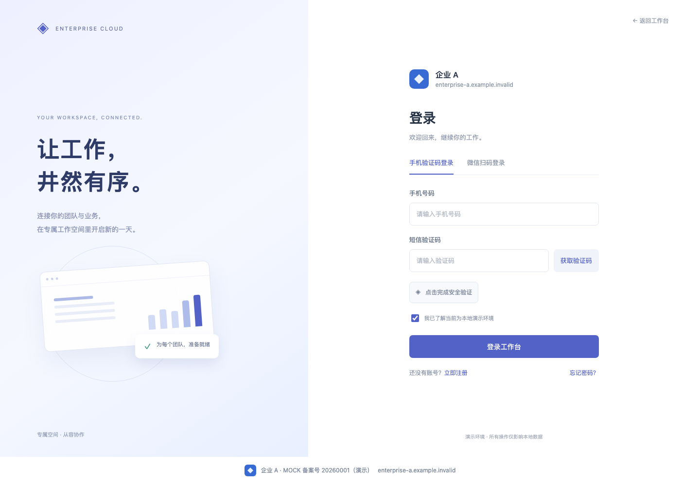
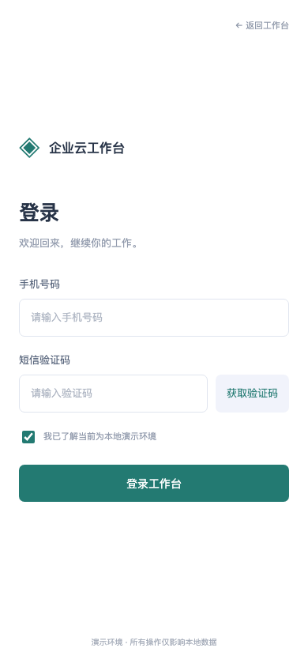
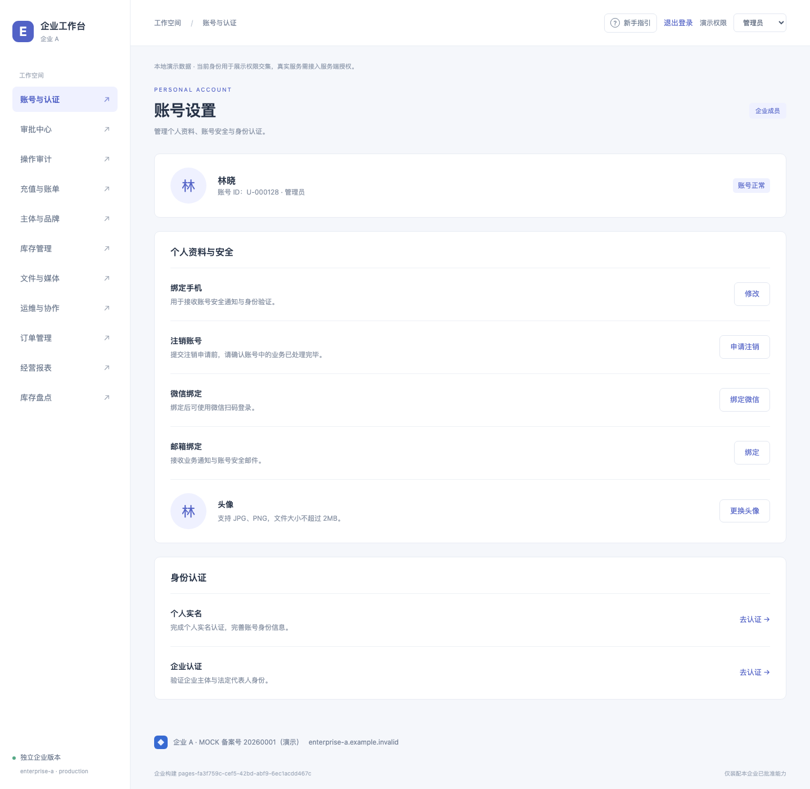
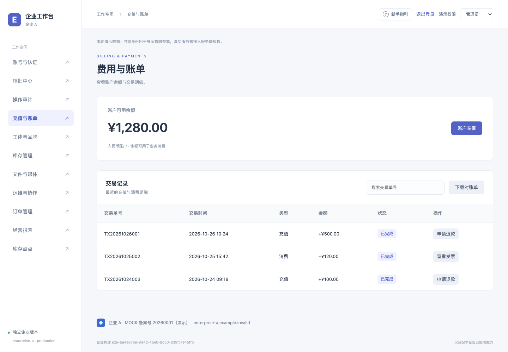
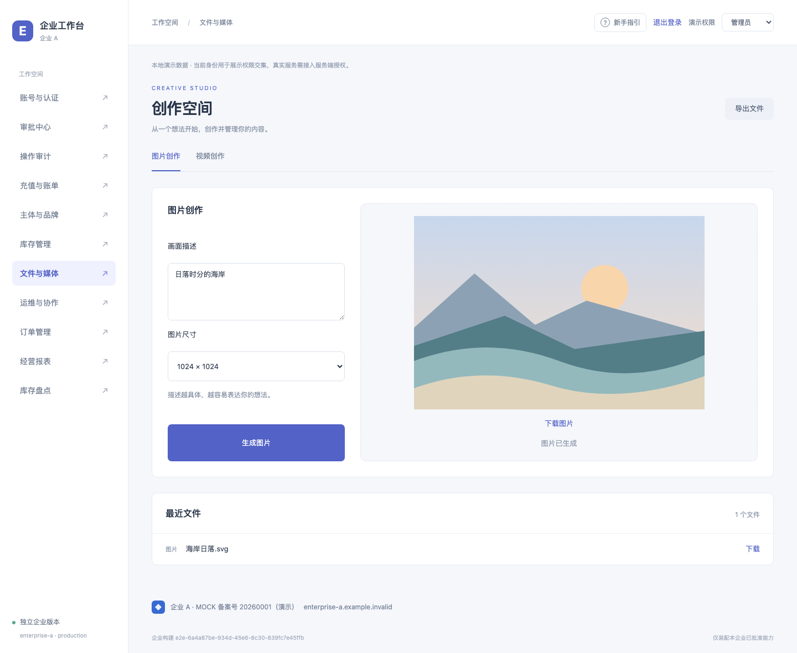
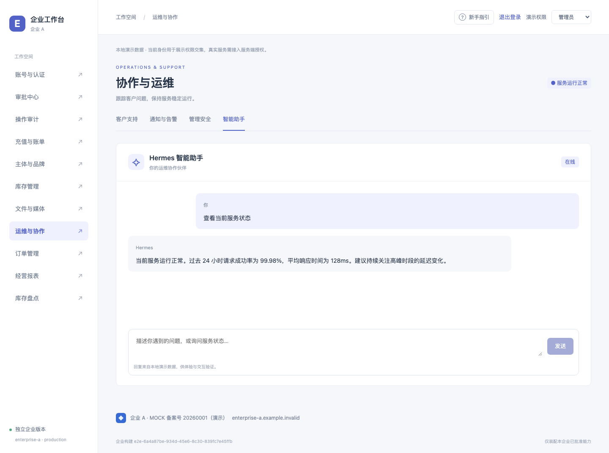

# 业务页面与企业定制裁剪验证

2026 年 10 月 26 日，外部依赖演示已改为正常产品页面。独立登录、注册、找回密码、账号设置、认证、账单、创作与运维流程由本地 Mock 服务支撑，用户页面不展示服务调试卡片、响应选择器或技术回执。

## 业务流程验证

| 页面           | 已验证的行为                                                                                   |
| -------------- | ---------------------------------------------------------------------------------------------- |
| 独立登录页     | 无工作台侧栏，短信与微信登录切换；短信发送、验证码、安全验证、进入工作台；定制版仅保留短信登录 |
| 注册与找回密码 | 独立路由；手机验证、设置密码、成功结果与返回登录；关闭能力后入口与路由一同消失                 |
| 账号设置       | 更换头像、换绑手机、邮箱绑定、微信扫码绑定、注销验证、个人实名与企业认证                       |
| 企业认证       | 企业资料、人脸核验、认证完成三个步骤；演示过程不采集摄像头                                     |
| 费用与账单     | 金额选择、扫码支付确认、余额与交易记录更新；逐笔退款、CSV 对账单下载、发票预览                 |
| 创作空间       | 图片预览、本地短片生成与播放、文件列表和 CSV 导出                                              |
| 协作与运维     | 工单同步、反馈表单、后台审批、企业微信扫码、二次认证改密、邮件通知、告警、运维指令与对话助手   |
| 主体与品牌     | 主体信息统一出现在登录页、页脚、开发示例和邮件模板；关闭后移除对应展示与 logo                  |

全部 28 项功能都通过对应的业务流程触达。失败和空数据由服务层会话夹具注入，验证失败后保留输入、请求可重试。页面没有「模拟响应」下拉框或卡片网格。

## 检查结果

| 检查                             | 结果                               |
| -------------------------------- | ---------------------------------- |
| 格式、严格类型、全部企业源码边界 | 通过                               |
| 单元与架构测试                   | 12 个文件，124 项通过              |
| 原业务生产站点浏览器回归         | 34 项通过                          |
| 配置控制台浏览器验收             | 13 项通过                          |
| 业务页面专项浏览器验收           | 10 项通过，覆盖全部 28 项功能      |
| 桌面与 390px 布局                | 登录和工作台页面均通过，截图已查看 |
| `git diff --check`               | 通过                               |

充值测试包含 125.50 元的小数金额，验证支付后余额和交易记录更新；退款从具体交易行发起并更新状态。媒体测试验证生成的图片、可播放的 Blob 视频、下载事件与文件列表，而非只检查成功文案。

## 定制与交付代码验证

企业 A 启用全部 120 项能力；`enterprise-mock-custom` 保留 17 项，包含短信登录、企业认证、退款、对账单、邮件通知、告警和模型调用。定制版没有注册、找回密码、个人实名、反馈、管理登录、创作与主体页面，相应地址直接访问显示未找到。

专项交付测试分别构建仅含本轮外部能力的 44 项全量组合与 17 项定制组合，执行来源审计、封包和包内容复验。检查未启用 owner 不存在于源码闭包、编译上下文和输出来源中，冻结站点也不含相应标识、业务文案和专属资源。保留服务仍被其他功能使用时继续交付。

全量版微信扫码页真实使用的二维码资源 URL，在定制版请求返回 404。仓库保留各模块源码，以便为不同企业独立构建。

## 固定版本与本地预览

| 版本       | Release ID                                   | 能力数 | 站点文件数 | 包大小      |
| ---------- | -------------------------------------------- | ------ | ---------- | ----------- |
| 全量企业 A | `pages-fa3f759c-cef5-42bd-abf9-6ec1acdd467c` | 120    | 120        | 132666 字节 |
| 定制示例   | `pages-595f86b8-b174-4c3b-a529-8a307103bf49` | 17     | 20         | 62794 字节  |

全量包 SHA-256：`e7214ba4d8f2e8b0ff6a29d9e98bb7fbcf2700c2cd9e2bec17d295cce7fffc85`。

定制包 SHA-256：`7164f0d40cb396af468e71608cce625e48118d1b4315686af869a50d15e601bb`。

已启动的预览分别使用上述封包后冻结的字节：[全量登录页](http://127.0.0.1:5291/access)、[定制登录页](http://127.0.0.1:5292/access)。配置控制台仍为 [本地打包控制台](http://127.0.0.1:5293/)。后续修改配置后，在新任务中打开对应固定版本预览。

## 页面截图

独立登录页：

定制版手机登录页：

账号设置：

费用与账单：

创作空间：

智能运维助手：

完整能力和路由映射见 [外部资源与定制规则](external-resources.md)。
