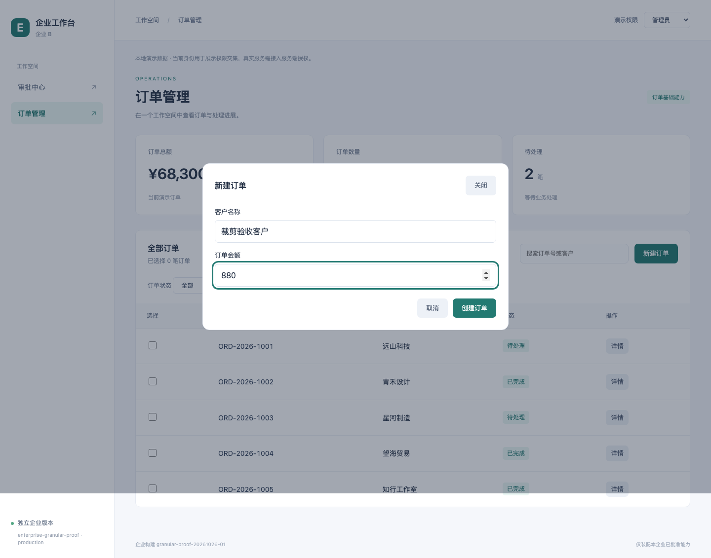
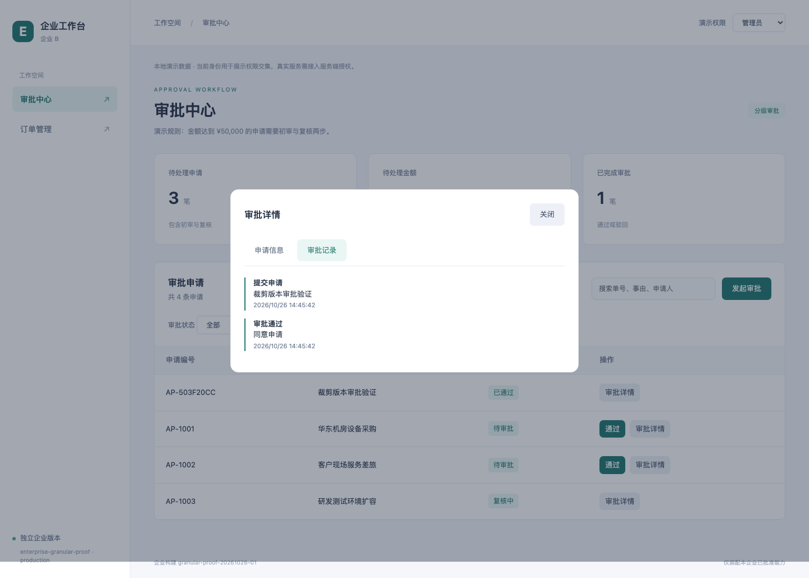

# 2026-10-26 精简企业实际交付验证

已创建企业配置 `enterprise-granular-proof`，从 120 项能力中显式保留 20 项，排除 100 项。使用同一工作区源文件分别执行精简版与企业 A 全量版的生产构建、审计、封包，并对两个压缩包逐项复验。报告状态：**passed**。

## 本次配置

| 范围       | 保留                         | 排除示例                                   |
| ---------- | ---------------------------- | ------------------------------------------ |
| 页面       | 订单管理、审批中心           | 库存、盘点、报表、审计、外部资源演示、指引 |
| 订单按钮   | 新建订单、详情               | 导出、批量完成、加急                       |
| 订单字段   | 客户名称、订单金额           | 客户参考号                                 |
| 订单列表列 | 客户、状态                   | 金额列                                     |
| 订单详情   | 基本信息页签                 | 跟进备注、扩展信息页签                     |
| 审批按钮   | 发起申请、初审通过、详情     | 驳回、复核通过                             |
| 审批字段   | 事由、申请人、金额、紧急程度 | 成本中心、初审意见、驳回原因、复核意见     |
| 审批列表列 | 事由、状态                   | 申请人、金额                               |
| 审批详情   | 申请信息、审批记录           | 扩展信息页签                               |

[实际企业清单](../config/enterprises/enterprise-granular-proof.json)。必填字段依赖完整，品牌为 `brand-b`。只关闭列表金额列时，金额输入、数据与已选择的详情金额仍保留。

## 对照结果

| 项目               |            全量企业 A |              精简企业 |
| ------------------ | --------------------: | --------------------: |
| 启用能力           |                   120 |                    20 |
| 交付文件           |                   120 |                    24 |
| 未压缩总字节       | 417,415（407.63 KiB） | 153,053（149.47 KiB） |
| 压缩包字节         | 131,840（128.75 KiB） |   59,552（58.16 KiB） |
| 导出 Worker        |                  存在 |                     0 |
| 本次检查的专属图片 |             17 项存在 |                     0 |

精简版交付字节减少 63.33%，压缩包字节减少 54.83%。大小变化作为辅助观察，裁剪结论以来源和包内字节验证为依据。

## 实际验证

1. 两个构建的完整源文件树摘要一致：`196f5b1e7d0643fc7c87849ee3237b7e9f48c0787e7c9008924307658375442f`。
2. 逐一检查 100 个未选 owner，在源码扫描输入、应用 / Worker 构建图输入、最终输出来源中全部为 0；所有已交付业务来源均属于 20 项白名单。
3. 13 项专属代码 / 样式标记在本次全量包中出现，在精简包中全部消失。包含导出文件名与样式、批量完成确认、加急、客户参考号校验、备注输入、驳回、复核、初审意见及成本中心校验、报表、指引和盘点过账。
4. 17 个全量图片产物的实际字节摘要，在精简输出中均不存在，包括收入图、二维码、外部资源图标和企业图标；精简版没有图片、source map、原始 TS / Vue 文件或 Worker 产物。
5. 从冻结生产站点启动临时 HTTP 服务，以 Chromium 实际创建订单、提交含紧急程度的审批、执行无意见字段的初审、查看申请与审批记录；核对表头与单元格列数一致，缺失按钮 / 字段 / 页签不可见。
6. 大额申请初审仍进入「复核中」，未安装复核能力不会变成直接通过。库存、报表、盘点深链显示未找到；所有网络资源均属于封包批准文件，浏览器运行错误为 0。
7. 浏览器验收后再次复验两个压缩包：文件集合、普通文件类型、每项字节长度和 SHA-256、站点摘要及包摘要均通过。

共享框架和已选择功能仍需使用的公共代码保留。金额等业务数据不会因关闭某一列表列而被删除。

## 制品与证据

逐项检查结果与下方截图已纳入仓库。交付包和原始审计是本机生成的制品，不随 Git 提交，可运行下方脚本重新生成。

- 本机精简交付包：`.artifacts/enterprise-granular-proof/granular-proof-20261026-01.tar.gz`
- 本机精简原始审计：`.audit/enterprise-granular-proof/granular-proof-20261026-01/audit.json`
- 逐能力、标记、资源和浏览器报告：[report.json](evidence/granular-proof-20261026-01/report.json)
- 本机全量对照审计：`.audit/enterprise-a/granular-proof-20261026-01-full/audit.json`
- 精简包 SHA-256：`6c2c78af351c3b2c165b1eb6ea057f616b5b45869fa9d45e879a2209f78eb356`
- 全量包 SHA-256：`58cd0d5f49d1edb6de8f914be167e7d766842cc34346ecf0eddc7e0397712d8b`





## 复现

在仓库根目录运行：

```bash
node --import tsx tests/verification/granular-delivery.ts
```

该验证入口每次生成新的 release ID，完整构建两份生产交付物，并输出报告与截图；不会修改现有企业选择。需要已经安装项目依赖和 Chromium。默认报告写入 `.audit/enterprise-granular-proof/<release-id>/granular-proof/`。

当前这份冻结站点可以用以下命令预览：

```bash
npm run preview -- --enterprise enterprise-granular-proof --release-id granular-proof-20261026-01 --port 5197
```
